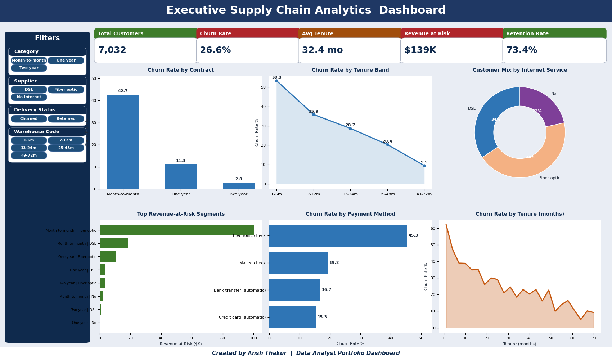

<div align="center">

# Data Analytics Portfolio
### Turning Raw Data into Business Strategy


</div>

---

**I answer business questions with data — including the ones where the answer is "don't do it."**

Three end-to-end analytics projects covering **50,000+ records**: a supply-chain P&L and
fulfilment audit, a ride-demand and pricing analysis, and subscription-retention analytics. Every figure below is
reproducible from the committed SQL and Python in this repository.

Plus a fourth, interactive capstone: an **Analytics Intelligence Copilot** that lets anyone
query all three datasets in plain English — with the math shown, not hidden.

As a **B.Sc IT graduate** and **Data Analyst**, I specialize in translating complex datasets into clean, reliable, and actionable business insights that drive real decisions.

---

## Portfolio at a Glance

| Project | Scale | Stack | Headline Result |
|---------|-------|-------|-----------------|
| **Supply Chain Performance** | 7,991 orders · 47 SKUs | Python · SQL · Excel | $73.0M net revenue / $21.2M profit analysed; late delivery proven systemic, not warehouse-specific |
| **Uber Trip Demand** | 35,000 trips | MySQL · Python · Power BI | 5–7 PM carries 31.2% of demand; airport trips are 39.6% of volume but 54.8% of revenue |
| **Subscription Retention** | 7,032 customers | Python · SQL · Excel | 26.6% churn; month-to-month + fiber = 72% of revenue at risk |
| **🤖 Analytics Copilot** *(interactive capstone)* | 50,034 records across all 3 | Streamlit · Pandas · Plotly · LangGraph · Groq | One-click insight chips, glass-box pandas logic, executive-brief generator — works offline, live chat with API key |

---

## Business Questions I Answered

If an interviewer asks one of these, the query and the number are already in this repo.

| Business Question | Finding | Decision It Drives |
|:--|:--|:--|
| Half our orders are late — which warehouse is at fault? | **None.** Only **0.08%** of delivery-time variance is between warehouses; all six have 2.82–2.88 day spread. | Fix upstream scheduling, not a facility — a per-site project would fix nothing |
| Isn't our biggest warehouse the worst offender? | **No — a volume illusion.** It causes 31.9% of late orders but handles 31.4% of all orders. | Always normalise counts by volume before ranking anything |
| Are discounts eating our margin? Should we cap them? | **Yes, at high levels.** Orders at 20%+ discount return only **4.64%** margin versus 31.02% in the 5–10% band. | Apply product-level profit floors and review 20%+ discounts |
| When should a ride-hailing firm surge-price? | **5–7 PM carries 31.2% of demand** in 3 of 24 hours — and the surge *starts* at 5 PM, not 6 PM when volume peaks. | Launch driver incentives by 4:30 PM, an hour ahead of peak |
| Do higher-rated drivers earn more per trip? | **No, and the obvious read is backwards.** Low-rated drivers show higher fares — but only because they drive longer trips. Fare-per-km is flat at ₹22.06–22.41. | Investigate long-trip rider experience; don't penalise drivers |
| Can we focus on just our top revenue zones? | **No.** It takes **4 of 5 zones** to reach 80% of revenue. | Keep coverage city-wide — the 80/20 assumption fails here |

**Six of these; four say "don't act."** Knowing where *not* to spend is the part that
saves budget.

---

## Core Analytical Skills & Tools

| Category | Technologies & Libraries | Key Methodologies |
| :--- | :--- | :--- |
| **Languages** | Python, SQL (MySQL / PostgreSQL), HTML/CSS | Exploratory Data Analysis (EDA), Statistical Analysis |
| **Data Libraries** | Pandas, NumPy, Matplotlib, Seaborn | Data Cleaning, Feature Engineering, Outlier Detection |
| **BI & Visualization** | Power BI, Microsoft Excel, openpyxl, Power Query, Pivots | Interactive Dashboard Design, Executive KPI Reporting |
| **Development Workflow** | Jupyter Notebooks, Git & GitHub, PowerShell / Bash | Automation Scripting, ETL Pipeline Construction |
| **SQL Techniques** | CTEs, `LAG()`, `RANK()`, `ROW_NUMBER()`, running `SUM() OVER`, `STDDEV_SAMP` | Cohort Banding, Pareto Analysis, Trend Detection |

---

## Featured Analytical Projects

### 1. [Inventory & Logistics Performance Analytics](./supply-chain-performance-analysis/)


*An end-to-end operational analytics project featuring a Python data cleaning pipeline, custom SQL metrics, and an automated, fully interactive 10-chart Excel dashboard.*
* **Business Challenge:** Half of all orders miss the 5-day delivery target, with $36.3M of net revenue exposed — and leadership needs to know whether to invest in a specific warehouse or the network.
* **Tech Stack:** Python (Pandas, openpyxl), SQL (MySQL — CTEs, `STDDEV`, `LAG`, window functions), Microsoft Excel (native charts and Pivot Tables).
* **Key Achievements:**
 * **Disproved the obvious answer.** Ranking warehouses by late-order count blames the largest site; variance decomposition shows only **0.08%** of delivery-time variance is between warehouses. Prevented a misdirected improvement programme.
* Cleaned and processed raw transactional data, generating consistent net revenue, **Delivery Days**, **Order-to-Ship Days**, and **Profit Margins** ($73.0M net revenue / $21.2M profit across 7,991 orders).
 * Implemented an automated Excel workbook generator (`build_excel_dashboard.py`) using `openpyxl` with dynamic dropdown selectors, date-range inputs, and custom formula-driven pivot tables.
 * Designed an executive **Summary** sheet containing KPI cards, performance grids, and narrative insights on fulfilment performance.
* Used **ABC Classification** to segment the 47-SKU catalogue by net-revenue contribution (A-items = 80.6% of net revenue) — with an honest read that this catalogue shows only moderate, not textbook 80/20, concentration.
 * Shipped a reproducible Python pipeline (`src/data_cleaning.py`, `src/analytics.py`, `src/build_excel_dashboard.py`) so every quoted figure regenerates from the raw data.

### 2. [Ride Demand & Revenue Analytics](./uber-trip-demand-analysis/)


*A comprehensive revenue and behavioral analysis of ride-sharing transactions using SQL data warehousing, Python visualization, and Excel dashboarding.*
* **Business Challenge:** Identifying when to surge-price, where to position premium vehicles, and which fleet tier to grow across 35,000 trips.
* **Tech Stack:** MySQL (window functions, CTEs, `LAG`, running totals), Python (Seaborn, Matplotlib), Advanced Excel, Power BI.
* **Key Achievements:**
 * Used `LAG()` to separate peak *volume* from peak *growth* — demand accelerates at **5 PM (+138%)**, an hour before the 6 PM volume peak, moving the incentive trigger an hour earlier.
 * Caught a confounded metric: lower-rated drivers appear to earn more, but the effect vanishes once trip distance is controlled for (**fare-per-km flat at ₹22.06–22.41**).
 * Quantified that **airport trips are 39.6% of volume but 54.8% of revenue** (₹535.77 vs ₹289.40 avg fare).
 * Built a MySQL schema over 35,000 records with `ROW_NUMBER()` deduplication and null validation.
 * Conducted vehicle-category analysis measuring revenue per ride and revenue-to-distance efficiency (Uber Black ₹40.06/km vs Uber Pool ₹14.08/km).
  * Reported three **negative findings** (no weekend fare effect, no seasonality, no zone concentration) that removed unjustified recommendations from an earlier draft.

### 3. [Subscription Retention Analytics](./subscription-retention-analytics/)



*End-to-end churn risk and revenue-at-risk analysis on 7,032 customers, delivered through a custom Python pipeline, SQL cohort analysis, and an interactive Excel dashboard.*
* **Business Challenge:** A subscription business is losing ~26% of customers. Which customers leave, when, why, and what revenue is exposed — so retention spend can be prioritised by dollars saved, not by gut feel.
* **Tech Stack:** Python (Pandas, Seaborn, openpyxl), SQL (MySQL — `LAG`, `RANK`, `STDDEV_SAMP`, CTEs), Microsoft Excel (native charts, filterable table), Jupyter.
* **Key Achievements:**
  * Built a 5-KPI, 6-chart executive Excel dashboard with a left-side Filters panel matching the supply-chain reference style — native, filterable, formula-driven from the ChartData sheet.
  * Identified **Month-to-month contracts churn at 42.7%** versus near-zero on two-year plans (chi-square = 1179.5, Cramér's V 0.41) and quantified that **month-to-month + fiber-optic = 72% of revenue at risk**.
  * Caught a confounder: fiber-optic customers churn more, but a large part of the effect is the contract mix, not the service itself — the dashboard splits the two.
  * Reported three **negative findings** (senior citizen flag not material, partner/dependents effect only via tenure, paperless billing not independent of payment method) that kept the recommendations honest.


### 4. [Analytics Intelligence Copilot](./analytics-intelligence-copilot/)

*The interactive capstone over all three datasets (50,034 records): pick a dataset, tap a
one-click insight chip, or ask anything in chat. Every answer ships as
**Finding → Business explanation → Suggested decision**, with an interactive Plotly chart
and an expandable **"🔍 Inspect logic & query"** panel showing the exact pandas code and
runtime — 0% hallucination by construction for chips.*
* **Business Challenge:** Recruiters and executives won't run SQL — but they will click one button. The agent makes every headline finding in this repo explorable in 60 seconds.
* **Tech Stack:** Streamlit, Pandas (deterministic analytics), Plotly, LangGraph ReAct agent + Groq LLM (optional live chat; full offline insight mode without a key).
* **Key Achievements:**
  * **9 quick-insight chips** whose figures are regression-tested against the committed SQL/outputs (e.g. SQL Q8 margin bands, `warehouse_performance.csv`, `churn_segment_revenue.csv`) — `pytest` → 18 passed.
  * **Analytical-trap guardrail:** the Warehouse Trap chip names the volume illusion (31.9% of late orders, 0.08% variance) and recommends *not* funding a per-site fix.
  * **Executive-brief generator:** one button → KPI cards, risks, decisions + Markdown download.
  * **Glass-box transparency:** no black-box numbers — pandas snippet + ms runtime under every card.

---

## 🤝 AI-Assisted Workflow & Validation Gates

AI accelerates every stage of my pipeline — it does not decide what ships. Each AI-assisted step passes a human validation gate before its output is trusted:

| Stage | AI Assists With | My Validation Gate |
| :--- | :--- | :--- |
| **Data cleaning** | Drafting dedup / null-handling logic | Row-count reconciliation against source; spot-checks on edge cases |
| **SQL analytics** | Query scaffolding & window-function drafts | Every query executed and its output reconciled with Python cross-checks |
| **EDA & visuals** | Chart selection, formatting, narrative drafts | Distribution and correlation checks that confirm or *challenge* the AI's framing |
| **Dashboards** | Layout scaffolding, DAX snippets | KPI figures traced back to committed SQL — no number ships unverified |
| **Documentation** | README structure & prose polish | Technical walkthroughs reviewed line-by-line against actual code behavior |

The principle: **AI is a co-pilot, not an oracle.** It drafts, I verify — because a hallucinated SQL window function that *looks* right is more dangerous than one that obviously fails. My headline findings (0.08% between-warehouse variance, flat ₹22/km fare-per-km) all survived validation that would have caught AI shortcuts.

---

## Repository Architecture

Each directory is fully self-contained, including its own documentation, SQL scripts, raw/cleaned datasets, and Jupyter analysis files:

```bash
data-analytics-projects/
│
├── supply-chain-performance-analysis/ # Operational efficiency & inventory dashboards
│ ├── src/ # Reproducible Python pipeline (clean, analytics, excel)
│ ├── data/ # Raw & processed CSV datasets (git-tracked)
│ ├── outputs/ # Generated KPI summary & analysis tables
│ ├── excel_analysis/ # Generated + interactive Excel dashboards
│ ├── powerbi/ # Power BI model guide (DAX measures, layout)
│ ├── sql_queries/ # Database schemas & analytical queries (.sql)
│ ├── image/ # Dashboard screenshots & visual highlights
│ ├── requirements.txt # Python dependencies
│ ├── Supplychain.ipynb # Python EDA & feature engineering notebook
│ └── README.md # Detailed project report and insights
│
├── uber-trip-demand-analysis/ # Ride-sharing demand & fare analytics
│ ├── data/ # Datasets & source structures
│ ├── excel_analysis/ # Excel pivot table summaries
│ ├── sql_queries/ # MySQL data-cleaning and analytics scripts (.sql)
│ ├── powerbi/ # Power BI report (.pbix)
│ ├── image/ # Visual analysis plots & demand curves
│ ├── UberTripAnalysis.ipynb # Interactive Python behavioral analytics
│ └── README.md # Complete project brief and recommendations
│
├── subscription-retention-analytics/ # Customer churn risk and retention analysis
│ ├── src/ # Excel dashboard + screenshot generators
│ ├── data/ # IBM Telco churn dataset
│ ├── outputs/ # Segment analysis tables
│ ├── excel_analysis/ # Native Excel dashboard
│ ├── sql_queries/ # MySQL cleaning and churn analysis
│ ├── image/ # EDA and dashboard visuals
│ ├── requirements.txt # Python dependencies
│ └── README.md # Detailed retention analysis
│
├── analytics-intelligence-copilot/ # Interactive AI copilot over all 3 datasets
│ ├── app.py # Streamlit: dataset switcher, insight chips, brief, chat
│ ├── src/ # datasets, analytics, brief, agent (LangGraph + offline mode)
│ ├── tests/ # 18 regression tests vs committed SQL/outputs
│ ├── requirements.txt # streamlit, pandas, plotly, langchain, langgraph
│ ├── FUTURE_IDEAS.md # 🔒 saved post-validation roadmap (locked)
│ └── README.md # Agent walkthrough + validation table
│
└── README.md # Main portfolio lander (this file)
```

---

## Contact & Collaboration

I am actively seeking entry-level **Data Analyst**, **Business Intelligence Analyst**, or **Data Engineer** roles where I can help teams turn complex data into clean, business-boosting decisions.

<div align="center">

[](https://ansh-thakur-netlify.netlify.app/)
[](https://gitlab.com/ansht_121/machine-learning-project)
[](https://www.linkedin.com/in/ansh-thakur-5407192b4/)
[](mailto:ansht1194@gmail.com)

</div>

Feel free to browse my code, download the interactive Excel dashboards to explore their dynamic filters, or connect with me on LinkedIn!
