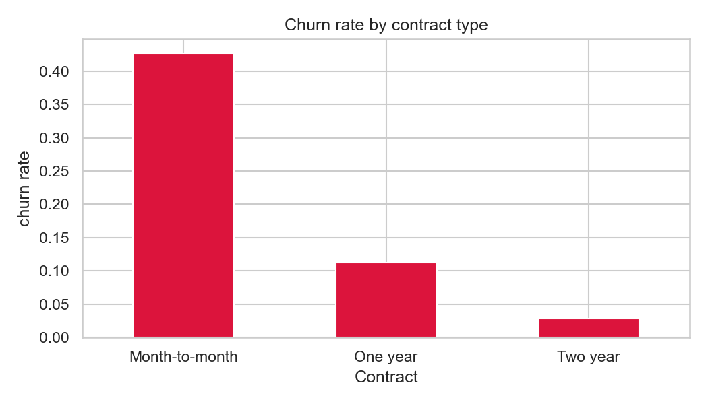
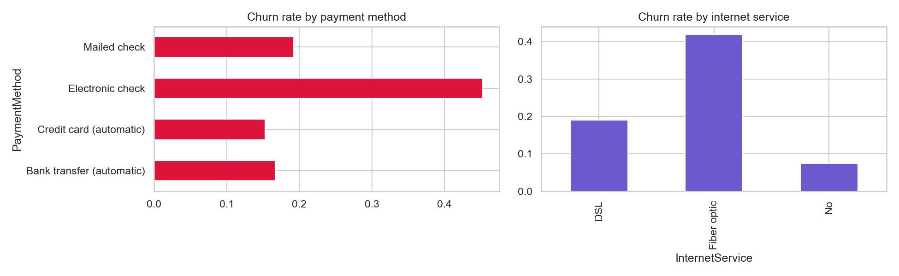
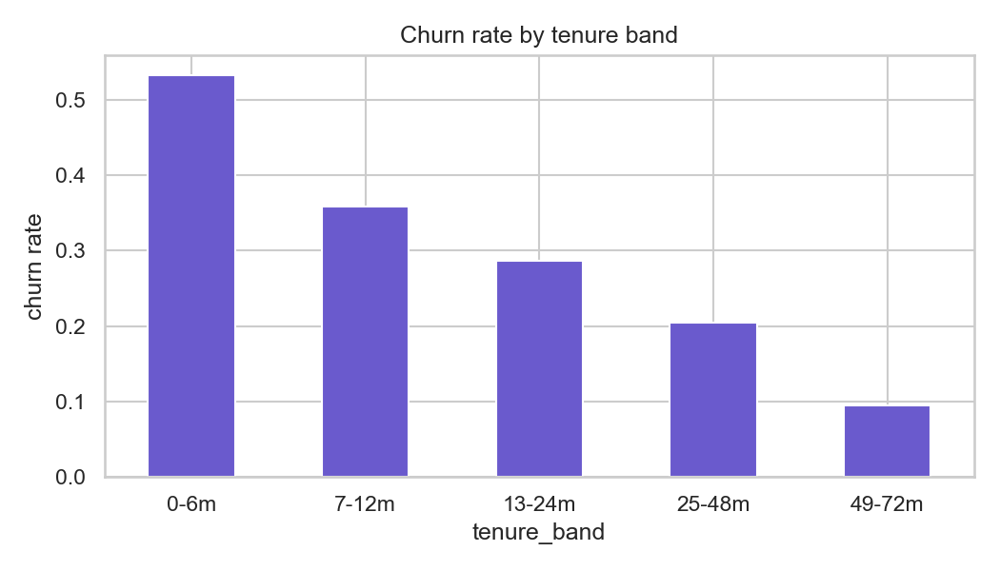
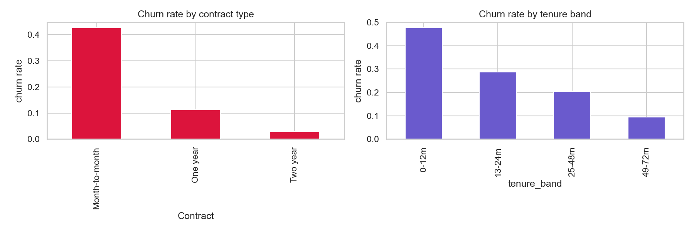
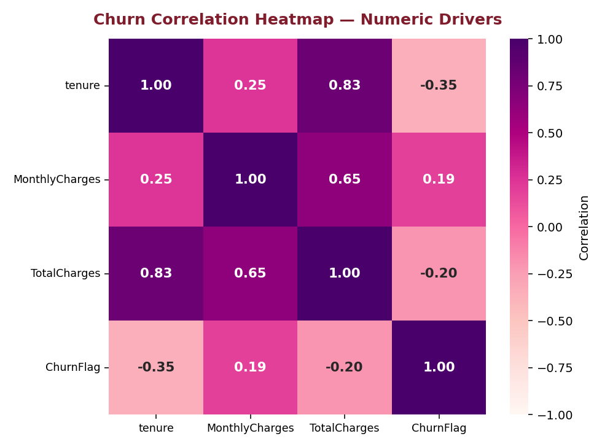
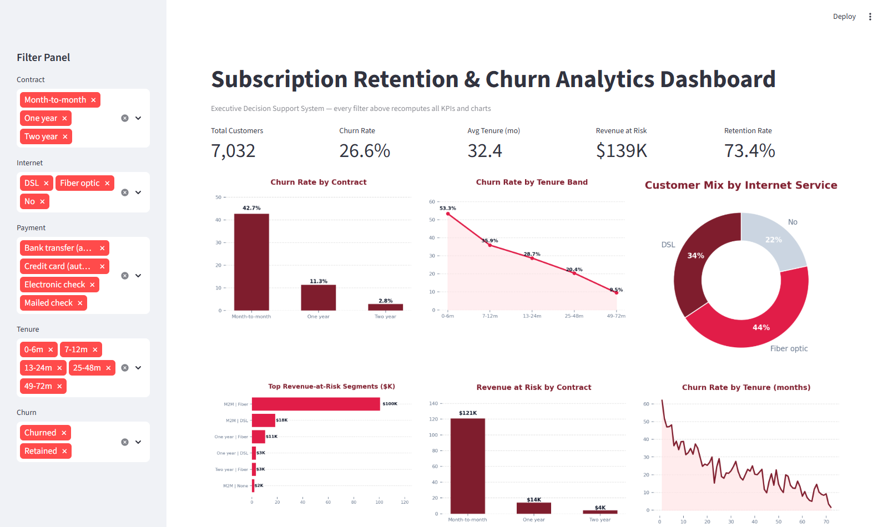

# Subscription Retention Analytics — Customer Churn Risk & Revenue-at-Risk Intelligence

**Business problem:** A subscription business (real-world telco data, 7,043 customers) is
losing ~26% of customers. Which customers leave, why, and what does the revenue at risk
look like?

> Data note: real-world dataset (IBM Telco customer-churn sample). Every figure below is
> reproducible from the committed notebooks, SQL scripts, and dataset.

---

## System Design Decisions

| Decision | Rationale |
| :--- | :--- |
| **EDA before modeling** | `Churn_EDA_Analysis.ipynb` establishes the KPI baseline and statistical validation (chi-square, Cramér's V) so modeling is built on verified segments, not raw flags |
| **Modular `src/` pipeline with tests** | data_processing → feature_engineering → modeling → evaluation → explainability — each stage pytest-covered, rerunnable, and independently debuggable |
| **Excel-native delivery dashboard** | A filterable customer table and charts the retention team can drive themselves |
| **Revenue-at-risk output over leaderboard** | The model's job is a ranked customer list with revenue exposure (`churn_segment_revenue.csv`), not an accuracy trophy |

## The Story in 3 Charts

1. **The assumption** — `image/churn_by_service_payment.png`: fiber-optic service looks like the churn villain.
2. **The evidence** — `image/churn_by_contract.png`: month-to-month contracts churn at 42.7% (chi-square 1179.5) — contract mix drives most of the fiber effect, and the dashboard splits the two.
3. **The decision** — `image/Churn_Dashboard_screenshot.png`: target month-to-month + fiber first — 72% of revenue at risk sits in one filterable segment.

---

## Repository Structure

```
subscription-retention-analytics/
├── Churn_EDA_Analysis.ipynb        # cleaning, KPI baseline, segment analysis, statistics
├── sql_queries/                    # 01_data_cleaning.sql + 02_churn_analysis.sql
├── src/build_churn_dashboard.py    # regenerates the Excel dashboard
├── src/render_dashboard_screenshot.py # renders the PNG dashboard preview
├── excel_analysis/Churn_Dashboard.xlsx  # native Excel charts + filterable customer table
├── data/Telco_Customer_Churn.csv   # raw dataset (7,043 customers, 21 columns)
├── image/                          # all charts generated by the notebook
├── outputs/                        # exported segment analysis tables
└── README.md
```

---

## SQL Analysis (`sql_queries/`)

Seven business questions answered in MySQL, each with an inline business-question / metric /
answer / action comment block (same style as the Uber and supply-chain repos).

| # | Question | Key query feature | Answer |
|---|---|---|---|
| 1 | Overall health? | aggregates | 7,032 customers, 26.6% churn |
| 2 | Which contract churns most? | GROUP BY | Month-to-month 42.7% |
| 3 | When do customers leave? | CASE + LAG() | first 12 months |
| 4 | Which services/payments? | GROUP BY | fiber 41.9%, e-check 45.3% |
| 5 | Fiber confounder? | GROUP BY contract within service | both service and mix |
| 6 | Where is revenue at risk? | RANK() OVER | month-to-month + fiber = 72% |
| 7 | Do churned customers pay more? | STDDEV_SAMP() | yes, higher bills |

---

## Excel Dashboard (`excel_analysis/Churn_Dashboard.xlsx`)


**Interactive native Excel workbook** (regenerate with `python src/build_churn_dashboard.py`):
- **Dashboard** sheet - navy title bar, left-side Filters panel (Contract / Internet / Payment / Tenure / Churn), 5 white KPI cards with coloured accent bars (driven by live SUBTOTAL formulas), six charts in a grid covering contract, tenure, internet service, payment method, revenue-at-risk segments, and tenure trend, plus a compact Key Findings panel — restyled to match the supply-chain executive design
- **Customer_Detail** sheet - an autofiltered Excel table with customer-level filters for contract, internet service, payment method, tenure, charges, and churn
- **ChartData** sheet - visible, chart-ready pivot tables for auditability

Open in Excel and click any chart or use the filter dropdowns to explore the data interactively.

---

## Statistical Validation (in `Churn_EDA_Analysis.ipynb`)

Every segment finding is tested formally (alpha = 0.05) with effect sizes, so the gaps are
structural, not sampling noise:

| Driver | Test | Statistic | p-value | Effect size |
|---|---|---|---|---|
| Contract type | Chi-square | chi2 = 1179.5 | < 0.001 | Cramér's V 0.41 (medium-large) |
| Internet service | Chi-square | chi2 = 728.7 | < 0.001 | Cramér's V 0.32 |
| Payment method | Chi-square | chi2 = 645.4 | < 0.001 | Cramér's V 0.30 |
| Online security | Chi-square | chi2 = 846.7 | < 0.001 | Cramér's V 0.35 |
| Tenure (churned vs kept) | Welch's t | t = -34.97 | < 0.001 | Cohen's d -0.86 (large) |
| Monthly charges | Welch's t | t = 18.34 | < 0.001 | Cohen's d 0.44 |
| Total charges | Welch's t | t = -18.80 | < 0.001 | Cohen's d -0.46 |

---

## KPI Baseline

| Metric | Value |
|---|---|
| Customers | 7,032 (after cleaning) |
| Churned customers | 1,869 |
| Churn rate | 26.6% |
| Monthly revenue | $456.1K |
| Monthly revenue at risk (churned) | $139.1K |
| Avg tenure | 32.4 months |

### KPI Handbook — what each headline number means

| KPI | Value | Definition |
|---|---|---|
| Total Customers | **7,032** | Rows after dropping missing `TotalCharges` (7,043 raw) |
| Churn Rate | **26.6%** | 1,869 churned / 7,032 customers |
| Avg Tenure | **32.4 months** | Mean months with the provider across all customers |
| Revenue at Risk | **$139.1K** | Sum of `MonthlyCharges` over churned customers (one month of their spend exposed) |
| Retention Rate | **73.4%** | `1 - churn rate` |

### Chart-by-chart walkthrough

**Churn Rate by Contract** — the single most decisive chart: month-to-month contracts churn at 42.7% against 11.3% (one-year) and 2.8% (two-year) — a ~15x ratio. Contract structure, not demographics, is the primary churn lever, which is why the retention budget recommendation targets 90-day contract conversion.



**Churn Rate by Tenure Band** — churn decays monotonically with tenure: 53.3% in the 0–6 month band falling to 9.5% at 49–72 months. The first year is the danger window; onboarding and early check-ins buy the most risk reduction per rupee.

**Revenue at Risk by Contract + Top Segments** — month-to-month contracts hold $121K of the $139K total exposure (~87%), and the M2M + Fiber segment alone is ~$100K (~72%). Retention spend is therefore rank-ordered by saved revenue, not by headcount — this ranked list (`outputs/churn_segment_revenue.csv`) is the deliverable the retention team actually acts on.

**Customer Mix by Internet Service** — Fiber 44%, DSL 34%, No internet 22%. Fiber is both the largest base and the highest-churn service, compounding the exposure above.



**Churn by Tenure (months)** — the continuous version of the band chart: churn starts above 60% in month 1, decays steeply through month 12, then flattens with noise. The elbow around month 12 marks where retention interventions lose leverage.



**Business View** — the stakeholder summary visual combining the headline segments for non-technical review.



**Correlation Heatmap (numeric drivers)** — tenure correlates **-0.35** with churn (longer stay, less churn) while monthly charges correlate **+0.19** (higher bills, more churn); tenure and total charges correlate **0.83** with each other by construction. The heatmap is why the model leans on contract/tenure structure rather than raw charges.



---

## Business Questions Answered

| # | Question | Finding | Action |
|---|---|---|---|
| Q1 | Which contract type churns most? | Month-to-month churns an order of magnitude more than two-year plans | Push annual conversion early in the customer lifecycle |
| Q2 | When do customers leave? | Churn falls steadily with tenure; the first 12 months are the danger window | Onboarding + early check-ins for new customers |
| Q3 | Which services/payments churn hardest? | Fiber-optic and electronic-check payers churn far more | Service-quality outreach + auto-pay incentives |
| Q4 | Is fiber-optic churn the service or the contract mix? | Confounder check splits the two effects (see notebook) | Target the right lever per segment |
| Q5 | Where is revenue at risk concentrated? | Segment table ranks contract x service by monthly revenue at risk | Prioritise retention spend by saved revenue |

---

## How to Reproduce

```bash
pip install -r requirements.txt
jupyter notebook Churn_EDA_Analysis.ipynb
```

All charts are saved to `image/` and analysis tables to `outputs/` by the notebook itself.

### Interactive dashboard (clickable filters — recommended)

```bash
streamlit run app.py
```

Opens a live web app where **every sidebar filter (Contract, Internet, Payment, Tenure, Churn status) recomputes all 5 KPI cards and all 6 charts instantly** — e.g. deselect "Two year" and watch Churn Rate jump from 26.6% to 34.1% as the lowest-risk segment leaves the view. Verified end-to-end with automated browser tests.

