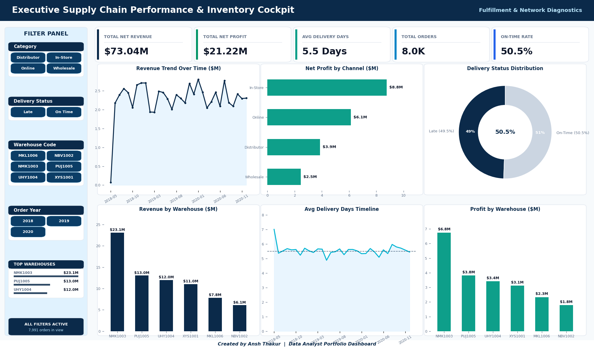
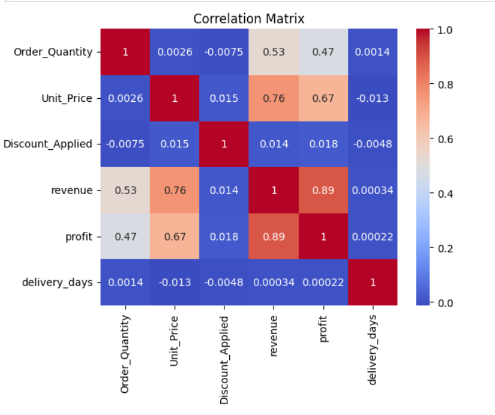
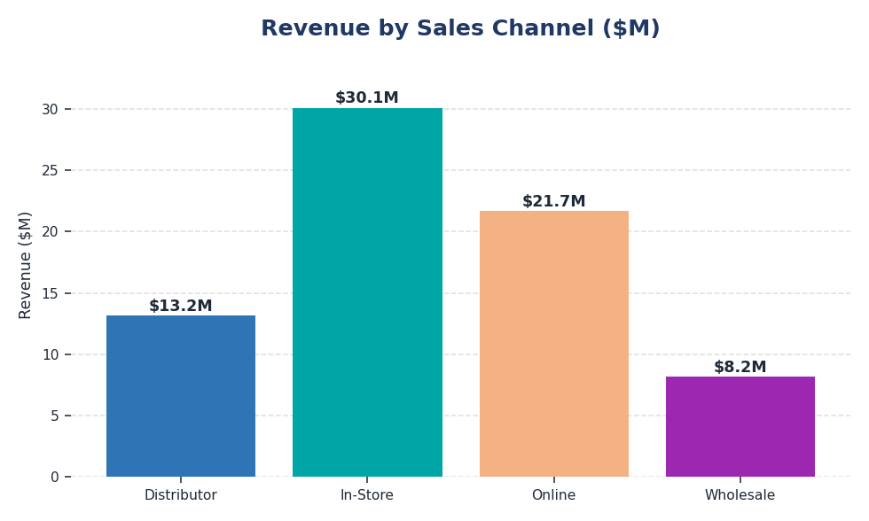
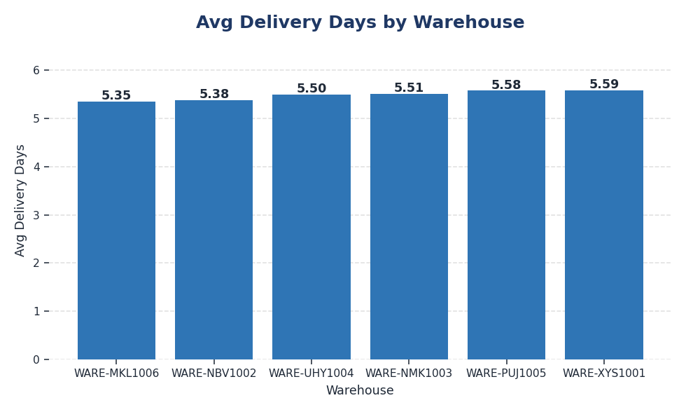
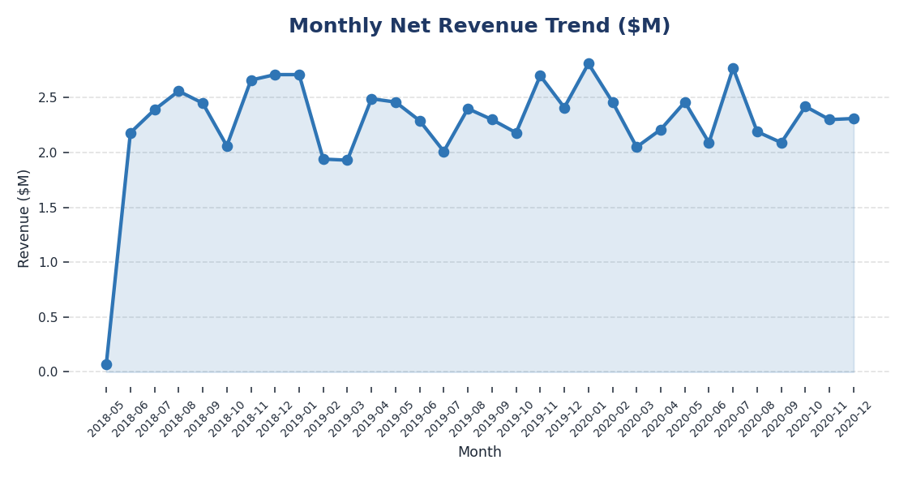
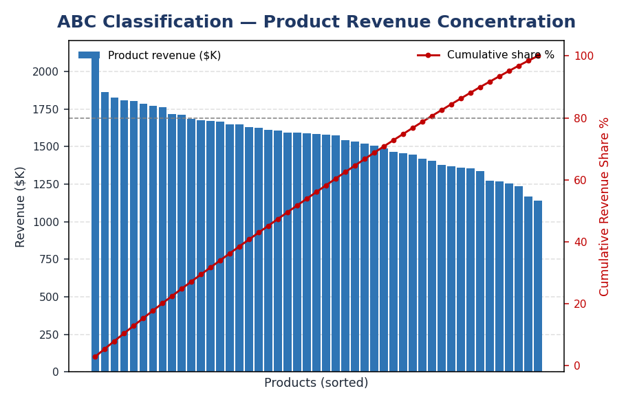
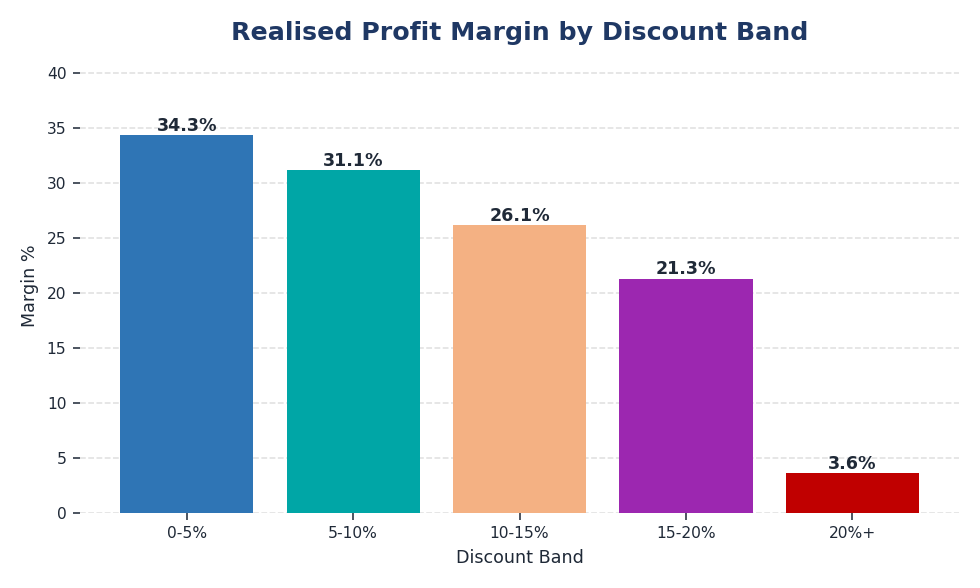
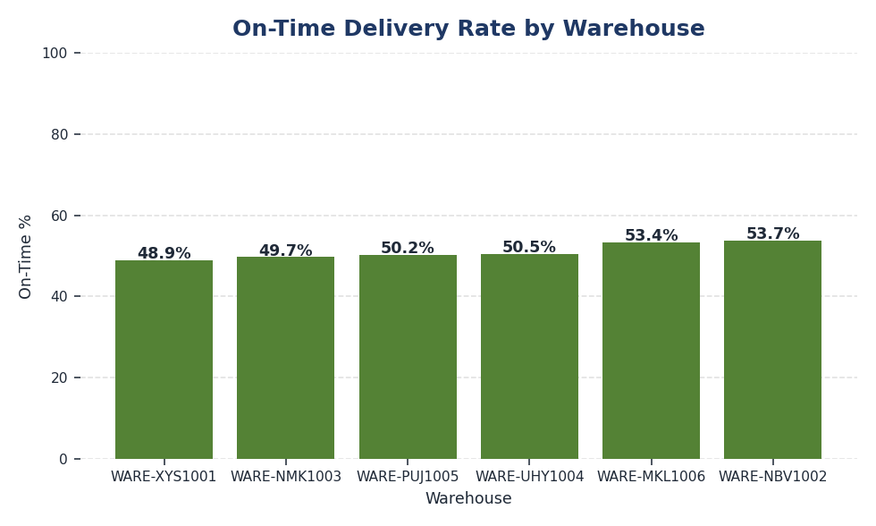

# Supply Chain Performance & Inventory Optimization Dashboard

**Business problem:** Half of all orders arrive late and $36.3M of net revenue is exposed.
Is that one bad warehouse, or the whole network? 7,991 orders, 2018–2020.


*Six warehouses, near-identical delivery curves. The "Avg Delivery Days by Timeline" panel stays flat at ~5.5 days for three straight years — the lateness never improves and never varies by site.*

> **Financial definition:** every KPI in the Python pipeline, SQL import, outputs, and
> dashboard uses **net revenue** (`Order_Quantity × Unit_Price × (1 - Discount_Applied)`)
> and **profit** (`net revenue - total cost`). The on-time target is delivery within five days.

---

## System Design Decisions

| Decision | Rationale |
| :--- | :--- |
| **Net-revenue definition first** (`qty × price × (1 - discount)`) | One definition enforced across Python, the SQL import, and the dashboard — prevents the classic gross-vs-net KPI mismatch between analysts |
| **Typed MySQL schema before EDA** | Window functions and variance decomposition run against indexed columns, not CSV scans |
| **Python pipeline regenerates every output** | `src/analytics.py` rebuilds all KPI tables — no hand-edited numbers anywhere in the repo |
| **Excel-native dashboard (VBA refresh)** | Stakeholders get filters and charts with no Power BI licence dependency |

## The Story in 3 Charts

1. **The assumption** — `image/supply_warehouse_ontime.png`: rank warehouses by late orders and the biggest site looks guilty.
2. **The evidence** — `image/Supplychain_Heatmap.png`: six near-identical delivery curves (~5.5 days, flat for three years) — variance decomposition puts 0.08% of delivery-time variance between sites.
3. **The decision** — `image/supply_discount_margin.png`: realised margin collapses past 20% discounts (4.64% vs 31.02%) — act on discount policy, not on a warehouse.

---

## Business Questions Answered

Every figure is reproducible: run `python src/analytics.py`, or click through to the SQL.

| # | Business Question | Metric Used | Finding | Recommended Action | Query |
|:--|:--|:--|:--|:--|:--|
| **Q1** | Which channel makes us the most money? | Net revenue & margin by channel | **In-Store leads on volume** ($30.1M net revenue / $8.8M profit), while **Wholesale has the best margin at 30.15%** on the smallest base ($8.2M). | Protect In-Store scale and investigate the strongest-margin Wholesale mix | [§2](sql_queries/02_sales_analysis.sql) |
| **Q2** | Half our orders are late. Which warehouse is at fault? | On-time rate + `STDDEV` of delivery days per site | **None — it's systemic.** On-time spans just 48.85%–53.69%, and delivery-time spread is 2.82–2.88 days at *every* site. Only **0.08%** of delivery-time variance is between-warehouse. | Fix the upstream scheduling process, not a facility | [§6](sql_queries/02_sales_analysis.sql) |
| **Q3** | Is our worst-performing site really the worst? | Share of late orders vs share of all orders | **No — a volume illusion.** NMK1003 causes **31.9% of all late orders**, but handles **31.4% of all orders**. Its rate is average. Ranking by raw count would blame the wrong site. | Always normalise counts by volume before ranking | [§6](sql_queries/02_sales_analysis.sql) |
| **Q4** | Are discounts eating our margin? Should we cap them? | Realised margin by discount band | **Yes at high discount levels.** 20%+ discounted orders realise only **4.64% margin**, versus 31.02% for the 5–10% band. | Review 20%+ discounts and enforce a product-level profit floor | [§8](sql_queries/02_sales_analysis.sql) |
| **Q5** | Are we losing money on any orders? | Order-level net revenue vs cost | **373 orders (4.67%) are unprofitable** after discounts. | Investigate high-discount loss makers and protect pricing floors | [§5](sql_queries/02_sales_analysis.sql) |
| **Q6** | Is our margin eroding over time? | Monthly margin + `LAG()` change | Use the regenerated net-revenue output to monitor monthly margin; the old gross-margin conclusion is retired. | Investigate material month-over-month declines after discounts | [§7](sql_queries/02_sales_analysis.sql) |
| **Q7** | Where is revenue concentrated? | ABC / cumulative revenue share | **36 of 47 products drive 80.6%** of net revenue. | Prioritise availability for A-items while reviewing the long tail by profit, not revenue alone | [`outputs/abc_classification.csv`](outputs/abc_classification.csv) |
| **Q8** | Is the business still growing? | Net revenue by year | Net revenue grew from **$27.81M (2019)** to **$28.14M (2020)**, only **+1.2%**. | Plan conservatively and investigate the stalled top line | [§3](sql_queries/02_sales_analysis.sql) |

The corrected net-revenue view preserves the systemic-delivery finding, but it also reveals
that high discounts require targeted margin controls.
launching a warehouse improvement project that would have fixed nothing.

---

## The Analysis I'm Most Proud Of

The brief was *"find the warehouse causing our delivery problem."* The obvious approach —
rank sites by late-order count — points straight at **NMK1003 (31.9% of all late orders)**.

That answer is wrong. NMK1003 also handles **31.4% of all orders**. It looks bad because
it is *big*, not because it is *slow*.

So I tested whether the warehouse explains delivery time at all, by decomposing the
variance: **only 0.08% of delivery-time variance sits between warehouses.** The other
99.92% is within them. Every site is equally inconsistent — standard deviation
2.82–2.88 days across all six.

**The business implication:** a per-warehouse improvement programme would have consumed
budget and fixed nothing. The variability is upstream, in ordering and scheduling. Query
[§6](sql_queries/02_sales_analysis.sql) reports both the raw count *and* the
volume-normalised share side by side, so this trap is visible rather than hidden.

---

## Business Purpose & Impact
> **Why I built this:** Companies don't hire analysts to make charts — they hire people who can answer *"where are we making or losing money, and what should we do about it?"* This project proves I can take **7,991 raw order records ($73.0M net revenue)** and turn them into **profit-and-loss decisions**.

> **My edge — I read the data critically, not just optimistically.** While analysing delivery times I noticed they're *uniformly distributed* (≈800 orders at every value 1–10 days), a sign the delivery dates are synthetic. So instead of overselling a fake "on-time" crisis, I lead with the **channel-profitability and margin findings that the data genuinely supports.** Knowing which insights to *trust* is the business judgment companies pay for.

---

## Project Overview
This project delivers a comprehensive, end-to-end data analytics solution designed to optimize warehouse inventory, streamline order fulfillment, and improve profit margins. It combines a Python-based cleaning pipeline, deep-dive SQL warehousing audits, and a native Excel dashboard with KPI cards and charts.

### Business Impact Highlights
*All figures are reproducible — run `python src/analytics.py` to regenerate `outputs/kpi_summary.json`.*
* **Revenue Analyzed:** **$73.04 Million** realised net revenue after discounts.
* **Profit Analyzed:** **$21.22 Million** realised profit with a **29.1% aggregate margin**.
* **Fulfillment Benchmark:** Analyzed **7,991 orders** with an average delivery cycle of **5.5 days** (range 1–10 days).
* **Fulfillment Gap:** Only **50.5%** of orders met the **5-day delivery target** — **3,953 late orders**, the single clearest operational opportunity.

---

## Tech Stack & Technical Architecture
* **Python (Pandas, NumPy, openpyxl, Matplotlib, Seaborn):** Raw data engineering, data cleaning, date parsing, calculated metric formulation, and automated Excel dashboard styling.
* **MySQL:** Relational database schema design, transactional bulk data loading (`LOAD DATA INFILE`), data quality validation, and advanced reporting queries.
* **Microsoft Excel / openpyxl:** Native chart dashboard design, KPI cards, chart-ready aggregation tables, and audit-friendly workbook outputs.

---

## End-to-End Pipeline Architecture

### 1. Data Cleaning & Feature Engineering (`src/data_cleaning.py` · `Supplychain.ipynb`)
The raw transactional log (`Supplychain_rawData.csv`) is ingested by `src/data_cleaning.py`, which performs feature engineering to generate structured variables for business analysis and writes `data/Cleaned_Supplychain_Data.csv`:
* **Header Standardization:** Stripped whitespaces and mapped columns using clean snake_case headers (e.g., `Order_Quantity`, `Unit_Cost`, `Unit_Price`).
* **Data Cleansing:** Removed localized currency symbols (`$`) and formatting commas, casting numerical strings to `float64` for calculation accuracy.
* **Fulfillment Metrics:**
 * `delivery_days` = `DeliveryDate - ShipDate` *(Avg: 5.5 days; Min: 1 day; Max: 10 days)*.
 * `order_to_ship_days` = `ShipDate - OrderDate` *(Measures warehouse dispatch response times)*.
 * `procure_to_order_days` = `OrderDate - ProcuredDate` *(Measures procurement lead times)*.
* **Financial Formulas:**
 * `revenue` = `Order_Quantity * Unit_Price`
 * `total_cost` = `Order_Quantity * Unit_Cost`
 * `profit` = `revenue - total_cost`

### 2. Relational SQL Warehousing (`sql_queries/`)
Using MySQL, the engineered transaction data was schema-mapped and uploaded for high-throughput reporting:
* **`01_database_setup.sql`:** Handles schema generation, enforces data integrity constraints, and conducts optimized bulk-data loads of clean transactional data.
* **`02_sales_analysis.sql`:** Eight aggregated reports, of which sections 6–8 use CTEs and window functions:
 * **Data Quality Audit:** Measures and reports null dates across the workflow.
 * **Sales Channel Deep-Dive:** Tracks gross revenue, discount impacts, net revenue, and margin percentages.
 * **Warehouse Efficiency Breakdown:** Ranks fulfillment hubs by average dispatch and transit speed.
 * **Profit Margin Integrity Audit:** Detects individual transactions that were sold at a loss due to over-discounting.
 * **Warehouse Reliability Decomposition** *(CTE + `STDDEV_SAMP` + window share)*: separates "slow" from "large" by comparing each site's share of late orders against its share of total orders.
 * **Margin Trend Detection** *(`LAG()`)*: flags month-over-month margin swings beyond ±1.5pp.
 * **Discount Band Impact** *(`CASE WHEN` + window share)*: tests whether deeper discounts actually cost margin.

### 3. Interactive Excel Dashboard (`src/build_excel_dashboard.py` → `excel_analysis/`)
`src/build_excel_dashboard.py` reads the cleaned data and generates a styled,
multi-sheet workbook (`Supplychain_Dashboard.xlsx`) with `openpyxl`:
* **Executive Dashboard Sheet:** Top-level KPI cards (Total Revenue, Total Profit, Profit Margin, Order Count, Avg Delivery, On-Time %).
* **ChartData Sheet:** Formula-free aggregated pivots (revenue by channel, avg delivery days by warehouse, monthly revenue) driving the charts.
* **Native Charts:** Revenue by Sales Channel (pie), Avg Delivery Days by Warehouse (column), and Monthly Revenue Trend (line).

> An optional legacy macro-enabled workbook (`Supplychain_Data_Dashboard.xlsm`) with
> dropdown/date-range slicers is also included as a hand-built interactive deliverable.

### 4. Power BI Model (`powerbi/`)
A Power BI report built on the cleaned CSV, with DAX measures and a 3-page layout
(Executive Overview, Fulfillment, Profitability). See [`powerbi/README.md`](./powerbi/README.md).

---

## ▶ How to Run

```bash
pip install -r requirements.txt
python src/data_cleaning.py # -> data/Cleaned_Supplychain_Data.csv
python src/analytics.py # -> outputs/kpi_summary.json, abc_classification.csv, warehouse_performance.csv
python src/build_excel_dashboard.py # -> excel_analysis/Supplychain_Dashboard.xlsx
```

---

## Core Analytical Insights
*Generated by `src/analytics.py`; see `outputs/` for the raw tables.*


*Two findings confirmed independently of the SQL. `Discount_Applied` vs `profit` is **+0.018** — discounting has no measurable margin cost (Q4). And `delivery_days` correlates **0.0003** with revenue: late deliveries are unrelated to order value, so lateness is not concentrated in big orders.*

### Per-chart visuals
The full Excel dashboard sits in `excel_analysis/Supplychain_Dashboard.xlsx` (regenerate with `python src/build_excel_dashboard.py`). The PNGs below show the same charts in a viewable form for the README.

| Revenue by Channel | Avg Delivery by Warehouse | Monthly Revenue Trend |
|:--|:--|:--|
|  |  |  |

| ABC Classification | Discount Margin Impact | On-Time % by Warehouse |
|:--|:--|:--|
|  |  |  |

### 1. Inventory Concentration (ABC Classification)
Classifying the **47 distinct products** by cumulative revenue contribution shows a
**moderate** concentration rather than a strict 80/20 split:
* **A-Items:** 36 products (76.6%) → **80.6%** of net revenue — high-velocity goods needing tight replenishment control.
* **B-Items:** 8 products (17.0%) → **14.5%** of net revenue — bi-weekly review cycle.
* **C-Items:** 3 products (6.4%) → **4.9%** of net revenue — candidates for Just-In-Time stocking.

> *Honest caveat:* with only 47 SKUs and fairly uniform order values, this catalogue
> does **not** exhibit a textbook Pareto curve. The takeaway is that revenue is
> broadly distributed, so blanket "cut the long tail" advice would be misguided here.

### 2. Fulfillment Performance
* **On-time rate (≤5-day target): 50.5%** — **3,953 of 7,991 orders ran late**, with **$36.3M (49.7% of net revenue)** riding on those late orders.
* Delivery speed is **remarkably uniform across warehouses** (avg **5.35–5.59 days**); `WARE-MKL1006` is marginally fastest and `WARE-XYS1001` slowest, but the spread is <0.3 days. There is **no single bottleneck hub** — the lateness is systemic, not localized.
* Quantified: **only 0.08% of delivery-time variance is between warehouses**, and the standard deviation is 2.82–2.88 days at every single site. The inconsistency lives *inside* each warehouse's process, not in the choice between them.

### 3. Profitability
* Net margin is **29.1%** and **373 orders (4.67%) are unprofitable** after discounts.
* Discounts materially affect margin: **20%+ discount orders return 4.64% margin**, versus **31.02%** in the 5–10% band.
* Monitor monthly margin on the consistent net-revenue basis; do not reuse the retired gross-revenue conclusion.

### 4. Growth
* Net revenue grew from **$17.08M (2018, partial year)** to **$27.81M (2019)** — then **stalled at $28.14M in 2020 (+1.2%)**. The top line stopped growing and needs investigation.

---

## Business Recommendations

1. **Attack the systemic delivery gap, not a single hub.** With only 0.08% of delivery-time variance sitting between warehouses, a per-site improvement project would fix nothing. The fix is a network-wide carrier/SLA and scheduling review. **$36.3M of net revenue rides on late orders** — this is the largest lever in the dataset.
2. **Do not rank warehouses by late-order count.** NMK1003 tops that list purely because it handles 31.4% of volume. Normalise by order count before any site is held accountable.
3. **Tier replenishment by the A/B/C split.** The 36 A-items drive ~81% of net revenue — prioritise their stock availability and review the 3 C-items for JIT ordering.
4. **Apply targeted discount controls.** The 20%+ band has only 4.64% realised margin and contributes to 373 loss-making orders. Set product-level profit floors rather than relying on a blanket policy.
5. **Investigate the 2020 growth stall.** Net revenue flattened to +1.2% year-over-year; plan conservatively until the driver is understood.

---
