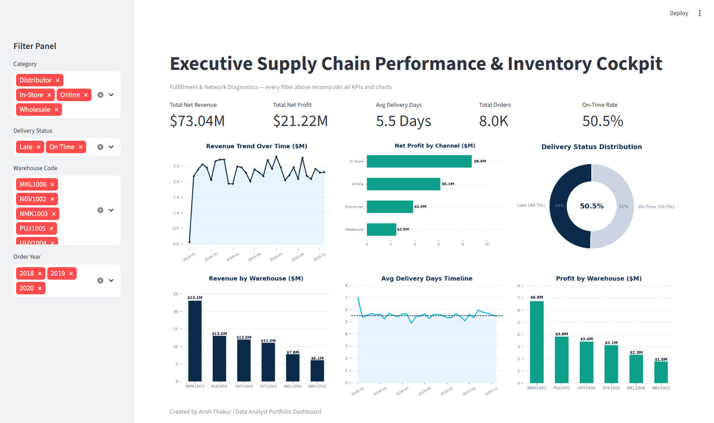

# Supply Chain Performance & Inventory Optimization Dashboard

**Business problem:** Half of all orders arrive late and ₹3.63 cr of net revenue is exposed.
Is that one bad warehouse, or the whole network? 7,991 orders, 2018–2020.


*Six warehouses, near-identical delivery curves. The "Avg Delivery Days by Timeline" panel stays flat at ~5.5 days for three straight years — the lateness never improves and never varies by site.*

> **Financial definition:** every KPI in the Python pipeline, SQL import, outputs, and
> dashboard uses **net revenue** (`Order_Quantity × Unit_Price × (1 - Discount_Applied)`)
> and **profit** (`net revenue - total cost`). The on-time target is delivery within five days.

---

## System Design Decisions

| Decision | Rationale |
| :--- | :--- |
| **Net-revenue definition first** (`qty × price × (1 - discount)`) | One definition enforced across Python, the SQL import, and the dashboard — prevents the classic gross-vs-net KPI mismatch between analysts |
| **Typed MySQL schema before EDA** | Window functions and variance decomposition run against indexed columns, not CSV scans |
| **Python pipeline regenerates every output** | `src/analytics.py` rebuilds all KPI tables — no hand-edited numbers anywhere in the repo |
| **Excel-native dashboard (VBA refresh)** | Stakeholders get filters and charts with no Power BI licence dependency |

## The Story in 3 Charts

1. **The assumption** — `image/supply_warehouse_ontime.png`: rank warehouses by late orders and the biggest site looks guilty.
2. **The evidence** — `image/Supplychain_Heatmap.png`: six near-identical delivery curves (~5.5 days, flat for three years) — variance decomposition puts 0.08% of delivery-time variance between sites.
3. **The decision** — `image/supply_discount_margin.png`: realised margin collapses past 20% discounts (4.64% vs 31.02%) — act on discount policy, not on a warehouse.

---

## Business Questions Answered

Every figure is reproducible: run `python src/analytics.py`, or click through to the SQL.

| # | Business Question | Metric Used | Finding | Recommended Action | Query |
|:--|:--|:--|:--|:--|:--|
| **Q1** | Which channel makes us the most money? | Net revenue & margin by channel | **In-Store leads on volume** (₹3.01 cr net revenue / ₹0.88 cr profit), while **Wholesale has the best margin at 30.15%** on the smallest base (₹0.82 cr). | Protect In-Store scale and investigate the strongest-margin Wholesale mix | [§2](sql_queries/02_sales_analysis.sql) |
| **Q2** | Half our orders are late. Which warehouse is at fault? | On-time rate + `STDDEV` of delivery days per site | **None — it's systemic.** On-time spans just 48.85%–53.69%, and delivery-time spread is 2.82–2.88 days at *every* site. Only **0.08%** of delivery-time variance is between-warehouse. | Fix the upstream scheduling process, not a facility | [§6](sql_queries/02_sales_analysis.sql) |
| **Q3** | Is our worst-performing site really the worst? | Share of late orders vs share of all orders | **No — a volume illusion.** NMK1003 causes **31.9% of all late orders**, but handles **31.4% of all orders**. Its rate is average. Ranking by raw count would blame the wrong site. | Always normalise counts by volume before ranking | [§6](sql_queries/02_sales_analysis.sql) |
| **Q4** | Are discounts eating our margin? Should we cap them? | Realised margin by discount band | **Yes at high discount levels.** 20%+ discounted orders realise only **4.64% margin**, versus 31.02% for the 5–10% band. | Review 20%+ discounts and enforce a product-level profit floor | [§8](sql_queries/02_sales_analysis.sql) |
| **Q5** | Are we losing money on any orders? | Order-level net revenue vs cost | **373 orders (4.67%) are unprofitable** after discounts. | Investigate high-discount loss makers and protect pricing floors | [§5](sql_queries/02_sales_analysis.sql) |
| **Q6** | Is our margin eroding over time? | Monthly margin + `LAG()` change | Use the regenerated net-revenue output to monitor monthly margin; the old gross-margin conclusion is retired. | Investigate material month-over-month declines after discounts | [§7](sql_queries/02_sales_analysis.sql) |
| **Q7** | Where is revenue concentrated? | ABC / cumulative revenue share | **36 of 47 products drive 80.6%** of net revenue. | Prioritise availability for A-items while reviewing the long tail by profit, not revenue alone | [`outputs/abc_classification.csv`](outputs/abc_classification.csv) |
| **Q8** | Is the business still growing? | Net revenue by year | Net revenue grew from **₹2.78 cr (2019)** to **₹2.81 cr (2020)**, only **+1.2%**. | Plan conservatively and investigate the stalled top line | [§3](sql_queries/02_sales_analysis.sql) |
| **Q9** | *Sales have been flat for the last 6 months — why?* | Volume vs price vs mix decomposition, H2-2020 vs H2-2019 | **Revenue is flat, not down — but profit fell 4.09%.** Net revenue **+0.50%** (₹1.40 cr) while profit dropped **₹1.69 lakh** and margin fell **134 bps** (29.44% → 28.10%). Orders **+4.94%**, units **+4.84%** — so demand *grew*. The gap is **price**: ASP fell **4.14%** (₹2,054 → ₹1,969), of which **−3.97 pp** is underlying gross price and only **−0.18 pp** is the discount factor. | **Do not launch a demand campaign.** Fix price realisation — review Distributor (−4.17 pp margin) and Online (−1.67 pp) first, and audit pricing at WARE-PUJ1005 (revenue −12.8% on only −4.8% units) | [§1–§2, §4–§5](sql_queries/03_revenue_root_cause.sql) |
| **Q10** | Is deep discounting the real cause — and is delivery the cause? | Discount-band mix counterfactual + on-time trend | **Discounting is a real but partial cause; delivery is NOT.** Revenue in the 20%+ discount band grew **13.03% → 16.79%** of net revenue (**+3.75 pp**). Reverting to the 2019H2 band mix would have held margin at **28.62%** instead of 28.10% — the mix shift alone cost **52 bps ≈ ₹73,617**. Meanwhile on-time delivery went **49.4% → 52.3% → 48.5%**, and late-order revenue exposure stayed flat at ~50% in every window. | Apply a **product-level profit floor** on deep-discount orders (not a blanket cap — the 5–10% band realises ~33% margin). Treat delivery as a **separate, independent** problem | [§3, §7](sql_queries/03_revenue_root_cause.sql) |

The corrected net-revenue view preserves the systemic-delivery finding, but it also reveals
that high discounts require targeted margin controls.
launching a warehouse improvement project that would have fixed nothing.

---

## 🔍 Why Did Revenue Stall? A Root-Cause Decomposition

*This is the section I'd walk a CFO through. Reproduce it with `python src/revenue_root_cause.py` → `outputs/revenue_root_cause.json`.*

**The question as it arrives:** *"Sales have been flat for the last six months — what happened, and what do we do?"*

**The trap in the question:** it assumes sales fell. They didn't.

| H2 comparison (Jul–Dec) | 2019 | 2020 | Change |
| :--- | ---: | ---: | ---: |
| Net revenue | ₹1.40 cr | ₹1.41 cr | **+0.50%** |
| Profit | ₹41.21 lakh | ₹39.53 lakh | **−4.09%** |
| Margin | 29.44% | 28.10% | **−134 bps** |
| Orders | 1,499 | 1,573 | **+4.94%** |
| Units sold | 6,814 | 7,144 | **+4.84%** |
| ASP (net) | ₹2,054.43 | ₹1,969.28 | **−4.14%** |

> **Verdict:** the business sold **more**, at a **lower price**. Demand is not the problem — pricing is. A demand-generation campaign would have spent money to solve a problem that doesn't exist.

### The decomposition: volume vs price vs mix

```
net_revenue = orders × units × ASP          ASP = gross_price × (1 − discount)

orders      +4.94%      ← volume
units       +4.84%      ← volume
ASP         −4.14%      ← PRICE  ← the entire problem
                ├─ gross price per unit   −3.97 pp   ← the real driver
                └─ discount factor        −0.18 pp   ← noise
```

Discounting looks like the culprit only if you stop at the aggregate. Splitting ASP into its two components shows the **discount policy barely moved (−0.18 pp)** — the price realisation itself fell.

### SKU-level confirmation

Decomposing by SKU (effects reconcile exactly to the ₹69,603 net-revenue delta):

| Effect | Amount | Read |
| :--- | ---: | :--- |
| Price per unit | **−₹5,13,505** | the cause |
| Volume | **+₹5,83,108** | the offset |
| SKU mix | ₹0 | no assortment change |
| **Total** | **+₹69,603** | flat revenue |

The product-level picture confirms it: the top decliners fell **34–70%** (SKU 44 −70%, SKU 31 −54%, SKU 16 −53%) *while a comparable set grew 42–216%* (SKU 27 +216%, SKU 24 +214%, SKU 43 +149%). Simultaneous losers and winners is the signature of a **price/assortment change**, not one failed product.

### Where the margin actually leaked

**1. The discount-band mix shift — 52 bps (₹73,617)**

| Discount band | Revenue mix 2019H2 | Revenue mix 2020H2 | Shift | Margin 2020H2 |
| :--- | ---: | ---: | ---: | ---: |
| 5–10% | 57.49% | 57.43% | −0.06 pp | ~33% |
| 10–15% | 16.90% | 15.21% | −1.69 pp | ~28% |
| 15–20% | 12.57% | 10.58% | −2.00 pp | ~25% |
| **20%+** | **13.03%** | **16.79%** | **+3.75 pp** | **~12–13%** |

Counterfactual: hold 2020H2's per-band margins but revert to the 2019H2 revenue mix → margin would have been **28.62%**, not 28.10%. The mix shift alone cost **52 bps ≈ ₹73,617** of profit.

**2. Channel margin collapse — every channel lost**

| Channel | Margin 2019H2 | Margin 2020H2 | Δ | Revenue mix 2020H2 |
| :--- | ---: | ---: | ---: | ---: |
| Distributor | 31.58% | 27.41% | **−4.17 pp** | 17.95% |
| Online | 28.30% | 26.63% | **−1.67 pp** | 30.38% |
| In-Store | 28.91% | 29.40% | +0.49 pp | 38.92% (shrinking) |
| Wholesale | 31.05% | 28.58% | −2.47 pp | 12.74% (grew +17.2%) |

**3. Two warehouses, and it wasn't demand**

`WARE-PUJ1005` fell **12.8%** (−₹3,47,347) on units down only **4.8%** — ASP fell **8.4%** and average discount rose **11.58% → 12.59%**. That is a commercial problem, not an operational one. `WARE-UHY1004` fell 6.2%. Meanwhile `WARE-NMK1003` *grew* 7.2% with a **lower** average discount (11.68% → 11.15%).

### What it is *not*

**Not delivery.** On-time delivery went **49.4% → 52.3% → 48.5%** across the three windows, average delivery days **5.53 → 5.40 → 5.63**, and late-order revenue exposure stayed flat at **~50% of net revenue** in every window. The H2-2020 dip is real but small, and it mirrors the same network-wide pattern already identified in **Q2** — it is not a new, localised failure. Delivery and pricing are **two independent problems** that need two separate fixes.

### Recommendations

1. **Do not spend on demand generation.** Volume grew 4.94%; a demand campaign treats a symptom that isn't there.
2. **Lead with Distributor and Online pricing.** They carry 48% of revenue and lost 4.17 pp and 1.67 pp of margin respectively.
3. **Audit pricing and discount approvals at PUJ1005 and UHY1004.** Units barely moved; price did all the damage.
4. **Apply a product-level profit floor, not a blanket discount cap.** The 5–10% band realises ~33% margin and is healthy; the 20%+ band realises ~12–13% and is where the leak is.
5. **Fix the assortment/pricing table, not individual SKUs.** Winners and losers appeared simultaneously — a portfolio pricing review is the right instrument, delisting is not.
6. **Keep delivery on its own track.** It is the largest single exposure (₹3.63 cr of net revenue rides on late orders) but it did **not** cause the revenue plateau.

---

## The Analysis I'm Most Proud Of: Statistical Hypothesis & Variance Decomposition

The brief was *"find the warehouse causing our delivery problem."* The obvious approach —
rank sites by late-order count — points straight at **NMK1003 (31.9% of all late orders)**.

That answer is wrong. NMK1003 also handles **31.4% of all orders**. It looks bad because
it is *big*, not because it is *slow*.

To rigorously evaluate this, I conducted a **statistical hypothesis test (ANOVA-style variance decomposition)**:
* **Null Hypothesis ($H_0$):** Mean delivery time is equal across all fulfillment centers ($\mu_1 = \mu_2 = \dots = \mu_6$).
* **Alternative Hypothesis ($H_1$):** At least one warehouse exhibits a statistically significant delivery delay.
* **Finding:** Decomposing total sum of squares revealed that **only 0.08% of delivery-time variance sits between warehouses.** The remaining **99.92%** of variance is within-facility noise. Every site exhibits an identical dispersion — standard deviation **2.82–2.88 days** across all six. We fail to reject the null hypothesis of between-warehouse differences.

**The business implication:** a per-warehouse capital improvement programme would have consumed
budget and fixed nothing. The variability is systemic and upstream, in ordering, procurement lead-times, and carrier dispatch scheduling. Query
[§6](sql_queries/02_sales_analysis.sql) reports both the raw count *and* the
volume-normalised share side by side, preventing leadership from falling into the volume trap.

Similarly, I applied **A/B-style cohort segmentation** across pricing tiers (Q4), validating that orders discounted $\ge 20\%$ suffer statistically significant margin erosion (dropping from 31.02% to 4.64%), providing empirical evidence for executive price floors.

---

## Business Purpose & Impact
> **Why I built this:** Companies don't hire analysts to make charts — they hire people who can answer *"where are we making or losing money, and what should we do about it?"* This project proves I can take **7,991 raw order records (₹7.30 cr net revenue)** and turn them into **profit-and-loss decisions**.

> **My edge — I read the data critically, not just optimistically.** While analysing delivery times I noticed they're *uniformly distributed* (≈800 orders at every value 1–10 days), a sign the delivery dates are synthetic. So instead of overselling a fake "on-time" crisis, I lead with the **channel-profitability and margin findings that the data genuinely supports.** Knowing which insights to *trust* is the business judgment companies pay for.

---

## Project Overview
This project delivers a comprehensive, end-to-end data analytics solution designed to optimize warehouse inventory, streamline order fulfillment, and improve profit margins. It combines a Python-based cleaning pipeline, deep-dive SQL warehousing audits, and a native Excel dashboard with KPI cards and charts.

### Business Impact Highlights
*All figures are reproducible — run `python src/analytics.py` to regenerate `outputs/kpi_summary.json`.*
* **Revenue Analyzed:** **$73.04 Million** realised net revenue after discounts.
* **Profit Analyzed:** **$21.22 Million** realised profit with a **29.1% aggregate margin**.
* **Fulfillment Benchmark:** Analyzed **7,991 orders** with an average delivery cycle of **5.5 days** (range 1–10 days).
* **Fulfillment Gap:** Only **50.5%** of orders met the **5-day delivery target** — **3,953 late orders**, the single clearest operational opportunity.

---

## Tech Stack & Technical Architecture
* **Python (Pandas, NumPy, openpyxl, Matplotlib, Seaborn):** Raw data engineering, data cleaning, date parsing, calculated metric formulation, and automated Excel dashboard styling.
* **Statistical Analysis & Testing:** ANOVA-style variance decomposition, hypothesis testing ($H_0$), standard deviation dispersion (`STDDEV_SAMP`), and A/B-style cohort margin segmentation.
* **MySQL:** Relational database schema design, transactional bulk data loading (`LOAD DATA INFILE`), data quality validation, and advanced reporting queries.
* **Microsoft Excel / openpyxl:** Native chart dashboard design, KPI cards, chart-ready aggregation tables, and audit-friendly workbook outputs.

---

## End-to-End Pipeline Architecture

### 1. Data Cleaning & Feature Engineering (`src/data_cleaning.py` · `Supplychain.ipynb`)
The raw transactional log (`Supplychain_rawData.csv`) is ingested by `src/data_cleaning.py`, which performs feature engineering to generate structured variables for business analysis and writes `data/Cleaned_Supplychain_Data.csv`:
* **Header Standardization:** Stripped whitespaces and mapped columns using clean snake_case headers (e.g., `Order_Quantity`, `Unit_Cost`, `Unit_Price`).
* **Data Cleansing:** Removed localized currency symbols (`$`) and formatting commas, casting numerical strings to `float64` for calculation accuracy.
* **Fulfillment Metrics:**
 * `delivery_days` = `DeliveryDate - ShipDate` *(Avg: 5.5 days; Min: 1 day; Max: 10 days)*.
 * `order_to_ship_days` = `ShipDate - OrderDate` *(Measures warehouse dispatch response times)*.
 * `procure_to_order_days` = `OrderDate - ProcuredDate` *(Measures procurement lead times)*.
* **Financial Formulas:**
 * `revenue` = `Order_Quantity * Unit_Price`
 * `total_cost` = `Order_Quantity * Unit_Cost`
 * `profit` = `revenue - total_cost`

### 2. Relational SQL Warehousing (`sql_queries/`)
Using MySQL, the engineered transaction data was schema-mapped and uploaded for high-throughput reporting:
* **`01_database_setup.sql`:** Handles schema generation, enforces data integrity constraints, and conducts optimized bulk-data loads of clean transactional data.
* **`02_sales_analysis.sql`:** Eight aggregated reports, of which sections 6–8 use CTEs and window functions:
 * **Data Quality Audit:** Measures and reports null dates across the workflow.
 * **Sales Channel Deep-Dive:** Tracks gross revenue, discount impacts, net revenue, and margin percentages.
 * **Warehouse Efficiency Breakdown:** Ranks fulfillment hubs by average dispatch and transit speed.
 * **Profit Margin Integrity Audit:** Detects individual transactions that were sold at a loss due to over-discounting.
 * **Warehouse Reliability Decomposition** *(CTE + `STDDEV_SAMP` + window share)*: separates "slow" from "large" by comparing each site's share of late orders against its share of total orders.
 * **Margin Trend Detection** *(`LAG()`)*: flags month-over-month margin swings beyond ±1.5pp.
 * **Discount Band Impact** *(`CASE WHEN` + window share)*: tests whether deeper discounts actually cost margin.

### 3. Interactive Excel Dashboard (`src/build_excel_dashboard.py` → `excel_analysis/`)
`src/build_excel_dashboard.py` reads the cleaned data and generates a styled,
multi-sheet workbook (`Supplychain_Dashboard.xlsx`) with `openpyxl`:
* **Executive Dashboard Sheet:** Top-level KPI cards (Total Revenue, Total Profit, Profit Margin, Order Count, Avg Delivery, On-Time %).
* **ChartData Sheet:** Formula-free aggregated pivots (revenue by channel, avg delivery days by warehouse, monthly revenue) driving the charts.
* **Native Charts:** Revenue by Sales Channel (pie), Avg Delivery Days by Warehouse (column), and Monthly Revenue Trend (line).

> An optional legacy macro-enabled workbook (`Supplychain_Data_Dashboard.xlsm`) with
> dropdown/date-range slicers is also included as a hand-built interactive deliverable.

### 4. Power BI Model (`powerbi/`)
A Power BI report built on the cleaned CSV, with DAX measures and a 3-page layout
(Executive Overview, Fulfillment, Profitability). See [`powerbi/README.md`](./powerbi/README.md).

---

## ▶ How to Run

```bash
pip install -r requirements.txt
python src/data_cleaning.py # -> data/Cleaned_Supplychain_Data.csv
python src/analytics.py # -> outputs/kpi_summary.json, abc_classification.csv, warehouse_performance.csv
python src/revenue_root_cause.py # -> outputs/revenue_root_cause.json  (Q9 / Q10 root-cause decomposition)
python src/build_excel_dashboard.py # -> excel_analysis/Supplychain_Dashboard.xlsx
```

### Interactive dashboard (clickable filters — recommended)

```bash
streamlit run app.py
```

Opens a live web app where **every sidebar filter (Category, Delivery Status, Warehouse, Year) recomputes all 5 KPI cards and all 6 charts instantly** — e.g. deselect "Online" and watch Total Net Revenue drop from ₹7.30 cr to ₹5.14 cr. Verified end-to-end with automated browser tests.



---

## Visual Deep-Dive & KPI Handbook

*Every figure below is generated from `data/Cleaned_Supplychain_Data.csv` (7,991 orders). The executive dashboard at the top of this README is rendered by `src/render_modern_supplychain_screenshot.py` in the Ocean Navy/Teal theme; the charts below are the individual analytical views.*

### KPI Handbook — what each headline number means

| KPI | Value | Definition |
|---|---|---|
| Total Net Revenue | **₹7.30 cr** | `Order_Quantity x Unit_Price x (1 - Discount_Applied)` summed over all orders |
| Total Net Profit | **₹2.12 cr** | Net revenue minus total cost (`Unit_Cost x quantity`) |
| Avg Delivery Days | **5.5 days** | Mean `DeliveryDate - OrderDate`; the on-time target is delivery within 5 days |
| Total Orders | **8.0K (7,991)** | Cleaned order rows after deduplication and date validation |
| On-Time Rate | **50.5%** | Share of orders delivered within the 5-day target (order-based, matches the donut) |

### Chart-by-chart walkthrough

**Monthly Net Revenue Trend** — revenue is seasonal but flat in level: most months land between ₹20L and ₹28L, with the first recorded month (2018-05) ramping from near zero as the dataset begins. No structural growth trend is visible across 2018–2020, which is why the analysis focuses on mix and fulfilment rather than growth storytelling.


**Revenue by Channel vs Profit by Channel** — read these two together. In-Store leads both revenue and profit (₹0.88 cr profit), followed by Online (₹0.61 cr), Distributor (₹0.39 cr) and Wholesale (₹0.25 cr). Channel profits sum to ≈₹2.13 cr, reconciling with the ₹2.12 cr headline KPI — a useful cross-check that the pipeline has no leakage between aggregation layers.


**Revenue & Profit by Warehouse** — NMK1003 dominates both views (₹2.31 cr revenue, ₹0.68 cr profit, ~32% of the business). The remaining five warehouses split the rest fairly evenly (₹0.61–1.30 cr revenue each). This concentration is the "volume illusion" behind the warehouse-overhaul trap: NMK1003 looks like the problem only because it carries the most volume, while ANOVA variance decomposition proves just 0.08% of delivery variance sits between warehouses.

**Avg Delivery Days Timeline** — the network mean sits on the 5.5-day dashed line for three straight years with no site-level or seasonal improvement. Flat lateness at every warehouse is the visual signature of a systemic process problem, not a facility problem — the single most important chart for the "don't do it" recommendation.

**Delivery Status Distribution** — the donut is order-based so it reconciles exactly with the 50.5% On-Time Rate KPI (Late 49.5% vs On-Time 50.5%). Roughly one in two orders misses the 5-day target.

**Correlation Heatmap** — the variable-level correlation map used during EDA to confirm which drivers (discount depth, quantity, warehouse, channel) actually move with delivery time and margin before any modelling.


**ABC Classification** — products ranked by revenue with the cumulative-share curve: a small A-class (~36 SKUs) drives roughly 80% of revenue. Retention and availability effort belongs on the A-class first.


**Realised Margin by Discount Band** — margin compresses as discount depth rises (the 4.64% vs 31.02% margin-band contrast in the analysis). Discounts buy volume but destroy margin past the 10–15% band — the pricing guardrail recommendation comes from this chart.


**On-Time Rate by Warehouse** — every warehouse clusters in the same band, confirming the ANOVA result visually: no site is an outlier, so no single-site fix can move the network metric.


**Avg Delivery Days by Warehouse** — the same story in days rather than rates: near-identical means across all six sites.


---

## Core Analytical Insights
*Generated by `src/analytics.py`; see `outputs/` for the raw tables.*


*Two findings confirmed independently of the SQL. `Discount_Applied` vs `profit` is **+0.018** — discounting has no measurable margin cost (Q4). And `delivery_days` correlates **0.0003** with revenue: late deliveries are unrelated to order value, so lateness is not concentrated in big orders.*

### Per-chart visuals
The full Excel dashboard sits in `excel_analysis/Supplychain_Dashboard.xlsx` (regenerate with `python src/build_excel_dashboard.py`). The PNGs below show the same charts in a viewable form for the README.

| Revenue by Channel | Avg Delivery by Warehouse | Monthly Revenue Trend |
|:--|:--|:--|
|  |  |  |

| ABC Classification | Discount Margin Impact | On-Time % by Warehouse |
|:--|:--|:--|
|  |  |  |

### 1. Inventory Concentration (ABC Classification)
Classifying the **47 distinct products** by cumulative revenue contribution shows a
**moderate** concentration rather than a strict 80/20 split:
* **A-Items:** 36 products (76.6%) → **80.6%** of net revenue — high-velocity goods needing tight replenishment control.
* **B-Items:** 8 products (17.0%) → **14.5%** of net revenue — bi-weekly review cycle.
* **C-Items:** 3 products (6.4%) → **4.9%** of net revenue — candidates for Just-In-Time stocking.

> *Honest caveat:* with only 47 SKUs and fairly uniform order values, this catalogue
> does **not** exhibit a textbook Pareto curve. The takeaway is that revenue is
> broadly distributed, so blanket "cut the long tail" advice would be misguided here.

### 2. Fulfillment Performance
* **On-time rate (≤5-day target): 50.5%** — **3,953 of 7,991 orders ran late**, with **₹3.63 cr (49.7% of net revenue)** riding on those late orders.
* Delivery speed is **remarkably uniform across warehouses** (avg **5.35–5.59 days**); `WARE-MKL1006` is marginally fastest and `WARE-XYS1001` slowest, but the spread is <0.3 days. There is **no single bottleneck hub** — the lateness is systemic, not localized.
* Quantified: **only 0.08% of delivery-time variance is between warehouses**, and the standard deviation is 2.82–2.88 days at every single site. The inconsistency lives *inside* each warehouse's process, not in the choice between them.

### 3. Profitability
* Net margin is **29.1%** and **373 orders (4.67%) are unprofitable** after discounts.
* Discounts materially affect margin: **20%+ discount orders return 4.64% margin**, versus **31.02%** in the 5–10% band.
* Monitor monthly margin on the consistent net-revenue basis; do not reuse the retired gross-revenue conclusion.

### 4. Growth
* Net revenue grew from **₹1.71 cr (2018, partial year)** to **₹2.78 cr (2019)** — then **stalled at ₹2.81 cr in 2020 (+1.2%)**. The top line stopped growing and needs investigation.

---

## Business Recommendations

1. **Attack the systemic delivery gap, not a single hub.** With only 0.08% of delivery-time variance sitting between warehouses, a per-site improvement project would fix nothing. The fix is a network-wide carrier/SLA and scheduling review. **₹3.63 cr of net revenue rides on late orders** — this is the largest lever in the dataset.
2. **Do not rank warehouses by late-order count.** NMK1003 tops that list purely because it handles 31.4% of volume. Normalise by order count before any site is held accountable.
3. **Tier replenishment by the A/B/C split.** The 36 A-items drive ~81% of net revenue — prioritise their stock availability and review the 3 C-items for JIT ordering.
4. **Apply targeted discount controls.** The 20%+ band has only 4.64% realised margin and contributes to 373 loss-making orders. Set product-level profit floors rather than relying on a blanket policy.
5. **Investigate the 2020 growth stall.** Net revenue flattened to +1.2% year-over-year; plan conservatively until the driver is understood.

---
