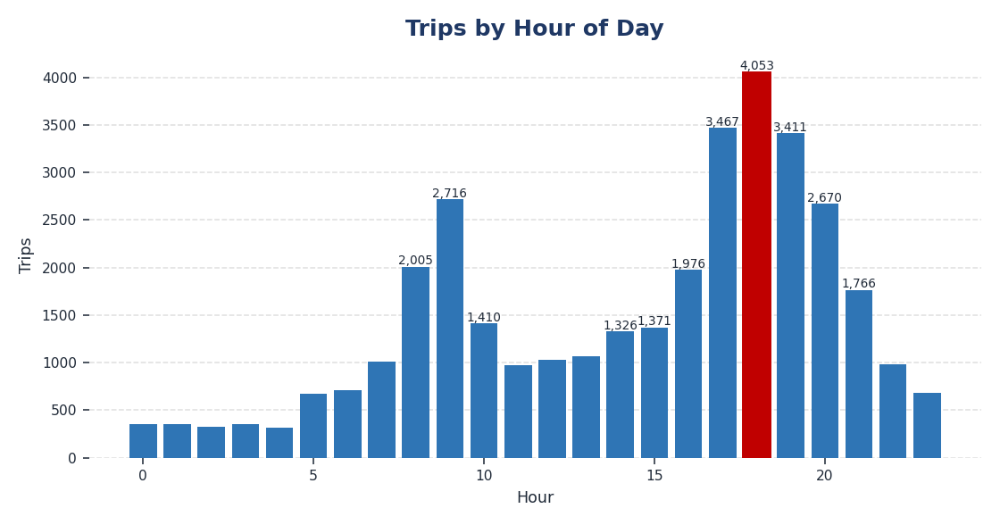
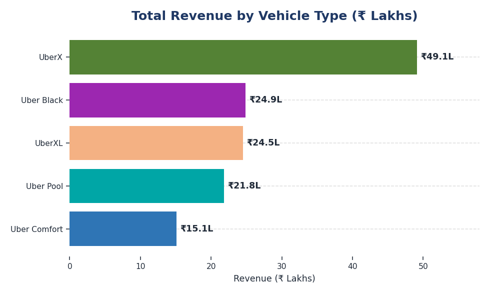
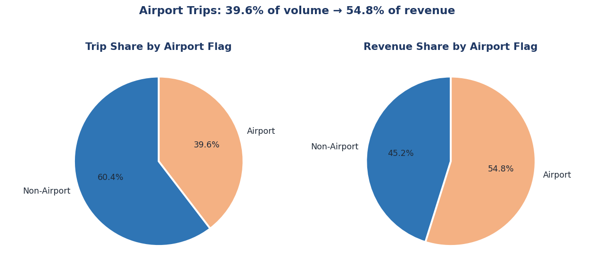
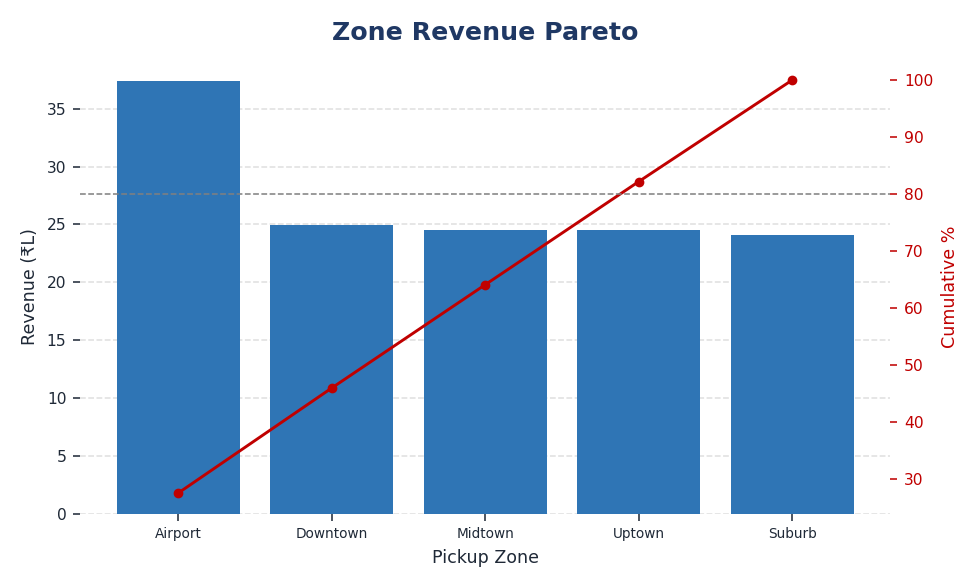
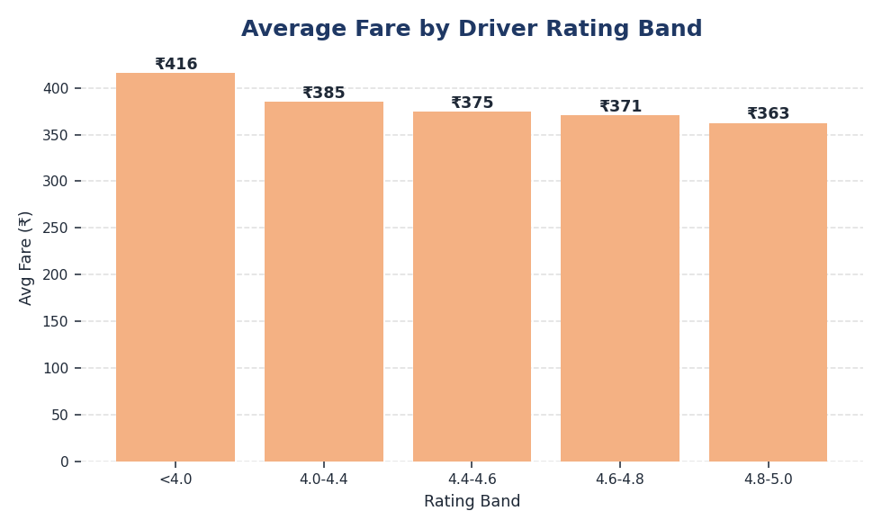

# Ride Demand & Revenue Analytics

**Business problem:** A ride-hailing operator needs to know *when* to surge-price, *where*
to position premium vehicles, and *which* fleet tier to grow — using 35,000 trip records.


*Demand is not spread evenly across the day — a single evening spike drives the business. The hourly bars show ~350 trips at 3 AM against 4,053 at 6 PM.*

> ℹ *Data note: this is a simulated dataset (uniform monthly volume, 5 pickup zones).
> The workflow and analytical techniques are the deliverable, not real Uber metrics.
> Fares are in ₹ (INR) — the dataset uses Indian payment methods including UPI.*

---

## ▶ How to Run
```bash
pip install pandas numpy matplotlib seaborn jupyter
# 1. Run the SQL queries in order: 01_data_cleaning.sql → 02_revenue_analysis.sql
# 2. Generate visuals: jupyter notebook UberTripAnalysis.ipynb
```
All charts are saved to `image/` by the notebook itself. Power BI report: [`powerbi/UberTrip_Dashboard.pbix`](powerbi/UberTrip_Dashboard.pbix).

---

## Business Questions Answered

Every figure below is reproducible from the committed SQL. Click a query link to verify.

| # | Business Question | Metric Used | Finding | Recommended Action | Query |
|:--|:--|:--|:--|:--|:--|
| **Q1** | When should we surge-price and add drivers? | Trips & revenue by hour | **5–7 PM carries 31.2% of all demand** (10,931 of 35,000 trips) in 3 of 24 hours. Peak hour is 6 PM (4,053 trips). | Concentrate incentives on the 5–7 PM window | [§2](sql_queries/02_revenue_analysis.sql) |
| **Q2** | How dependent are we on airport trips? | Revenue split by airport flag | Airport is **39.6% of trips but 54.8% of revenue** (₹74.3L). Avg fare ₹535.77 vs ₹289.40 — **1.85×**. | Protect airport supply; it is the highest-value corridor | [§4](sql_queries/02_revenue_analysis.sql) |
| **Q3** | Which fleet tier earns most per km? | Revenue ÷ distance by vehicle | Uber Black **₹40.06/km vs Uber Pool ₹14.08/km — 2.8×**. But UberX leads total revenue (₹49.1L) on volume. | Grow Black in premium zones; keep UberX as the backbone | [§3](sql_queries/02_revenue_analysis.sql) |
| **Q4** | Do higher-rated drivers earn more? | Avg fare by rating band | **No — and the obvious read is wrong.** Lowest-rated (<4.0) show the *highest* avg fare (₹419 vs ₹364). Cause is trip length (18.9 km vs 16.3 km), not driver quality: fare-per-km is flat at ₹22.06–22.41 across all bands. | Investigate rider experience on long trips — don't penalise drivers | [§11](sql_queries/02_revenue_analysis.sql) |
| **Q5** | Can we focus on just our top zones? | Cumulative revenue share | **No.** It takes **4 of 5 zones to reach 80%** of revenue. Only Airport stands out (27.6%); the rest sit at 17–19% each. | Keep coverage city-wide; a "top zones" strategy fails here | [§10](sql_queries/02_revenue_analysis.sql) |
| **Q6** | Should weekend pricing differ? | Avg fare by weekend flag | **No.** ₹389.34 vs ₹386.05 — a **0.9%** gap, with near-identical trip distance. | Do not build a weekend pricing tier | [§6](sql_queries/02_revenue_analysis.sql) |
| **Q7** | When does the evening rush actually *start*? | Hour-over-hour trip-volume change (`LAG`) | The query measures trip-volume acceleration separately from revenue, so incentive timing is based on demand rather than fare mix. | Use the highest positive trip-volume jump to schedule incentives; validate operationally | [§9](sql_queries/02_revenue_analysis.sql) |
| **Q8** | Is there visible within-year variation? | Trips and revenue by month | Monthly results describe one simulated year only; they do not establish recurring annual seasonality. | Use time-of-day for current operations; validate seasonality with multi-year production data | [§8](sql_queries/02_revenue_analysis.sql) |

**Three of these eight are negative findings.** Q5, Q6 and Q8 tell the business *not* to
act — which prevents wasted spend. Reporting them is part of the job.

---

## Project Overview
This project performs a comprehensive behavioral and financial analysis of a **synthetic ride-sharing transaction dataset** (35,000 trips, generated for portfolio demonstration). Using a two-stage SQL data cleaning pipeline, multi-dimensional MySQL reporting queries, and Excel pivot dashboards, the project uncovers peak demand windows, identifies high-revenue vehicle categories, and produces actionable pricing and allocation recommendations.

### Business Impact Highlights
* **Full Pipeline Coverage:** Built a `ROW_NUMBER()` + `DISTINCT` deduplication safeguard (the source data was already clean, so it removed 0 rows — the value is a reusable, production-style integrity step).
* **Revenue Deep-Dive:** Analyzed fare amounts, distances, and durations across **vehicle types, pickup zones, time periods, and weekend/weekday segments**.
* **Airport Insights:** Quantified airport trip share and its premium fare contribution relative to standard bookings.
* **Operational Recommendations:** Demand heatmap (hourly) used to define surge pricing windows and driver dispatch schedules.

---

## Tech Stack & Technical Architecture
* **MySQL (Window Functions, CTEs, Aggregations):** Two-script SQL pipeline — a dedicated cleaning script followed by a layered business intelligence script covering 11 analytical dimensions, including `LAG()` trend detection and running-total Pareto analysis.
* **Python (Pandas, Matplotlib, Seaborn):** EDA and visual storytelling in `UberTripAnalysis.ipynb`, including heatmaps, bar charts, and distribution plots.
* **Microsoft Excel (Pivot Tables, Charts):** Summary dashboard for stakeholder-ready reporting covering peak hours, vehicle revenue, and location performance.
* **Power BI:** Interactive `.pbix` dashboard for executive-level KPI monitoring.

---

## End-to-End Pipeline Architecture

### 1. Data Cleaning & Deduplication (`sql_queries/01_data_cleaning.sql`)
The raw CSV is loaded into a MySQL staging table and processed through a **two-stage deduplication pipeline**:

* **Stage 1 — Exact Row Deduplication:** `CREATE TABLE ... AS SELECT DISTINCT *` eliminates fully identical records.
* **Stage 2 — Trip-ID Deduplication:** `ROW_NUMBER()` partitions by `Trip_ID` and uses deterministic date, time, fare, distance, and driver tie-breakers to retain one record per trip. The source does not contain an update timestamp, so the pipeline does not claim to identify the most recently updated record.
* **Validation Checks:** Post-cleaning queries audit for null `Trip_ID`, `Fare_Amount`, and `Trip_Distance_km` fields to confirm pipeline integrity.

### 2. Business Intelligence Reporting (`sql_queries/02_revenue_analysis.sql`)
Eleven layered analytical queries that build from portfolio-level KPIs down to granular segment comparisons. Sections 9–11 use CTEs and window functions to answer questions a plain `GROUP BY` cannot:

| Query | Business Question Answered | Technique |
| :--- | :--- | :--- |
| **1. Portfolio KPI Summary** | What is the overall health of the business? | Aggregation |
| **2. Hourly Demand Heatmap** | Which hours should we surge-price? | `RANK()` |
| **3. Vehicle Performance** | Which vehicle type earns the most per km driven? | Ratio aggregation |
| **4. Airport Trip Analysis** | How much revenue depends on airport trips? | Window share |
| **5. Pickup Location Comparison** | Which zones generate the most revenue? | Aggregation |
| **6. Weekend vs. Weekday** | Should weekend pricing differ? | Aggregation |
| **7. Time-of-Day Periods** | Which part of day contributes most revenue? | Aggregation |
| **8. Monthly Revenue Trend** | Is there a seasonal cycle? | Aggregation |
| **9. Hour-over-Hour Growth** | *Where does the evening rush start?* | **CTE + `LAG()`** |
| **10. Zone Revenue Concentration** | *Can we focus on a few zones? (Pareto test)* | **Running `SUM() OVER`** |
| **11. Rating Band vs Fare** | *Do better-rated drivers earn more?* | **`CASE WHEN` banding** |

### 3. Visual EDA (`UberTripAnalysis.ipynb`)
Python-driven exploration of cleaned trip data including:
* **Heatmaps:** Hour × Day-of-Week demand matrix to visualize peak traffic windows.
* **Vehicle Revenue Charts:** Side-by-side comparison of total and per-km revenue.
* **Distribution Plots:** Fare and distance histograms to detect outliers and skew.
* **Pickup Location Bar Charts:** Top revenue zones ranked horizontally.

---

## Core Analytical Insights


*The correlation matrix independently confirms Q4: driver rating correlates **-0.13** with trip distance and only **-0.09** with fare. Longer trips rate worse — the rating gap is about trip length, not driver quality.*

### Per-chart visuals
The interactive Power BI dashboard sits in `powerbi/UberTrip_Dashboard.pbix` and the Excel summary in `excel_analysis/`. The PNGs below surface the same charts in a viewable form for the README.

| Hourly Demand | Vehicle Revenue | Airport Trip Share |
|:--|:--|:--|
|  |  |  |

| Zone Pareto | Fare by Driver Rating |
|:--|:--|
|  |  |

### 1. Peak Demand Windows
The hourly demand heatmap shows a clear **evening peak**: the busiest hours are **6 PM (4,053 trips), 5 PM (3,467), and 7 PM (3,411)** — a textbook after-work commute surge. Late-night fares are *not* meaningfully elevated in this data (≈2% above average), so the genuine operational signal is the evening volume spike, not a late-night premium.

Adding a `LAG()` comparison sharpens this into something actionable: **the surge begins at
5 PM, not 6 PM.** Peak *volume* and peak *growth* are different hours, and only the
hour-over-hour view reveals it. Incentives launched at 6 PM arrive an hour late.

### 2. Vehicle Category Revenue Efficiency
* **Revenue-per-km by tier** (total fare ÷ total distance, matching §3 of the SQL): Uber Black **₹40.06**, UberXL ₹26.65, Comfort ₹25.31, UberX ₹20.30, Uber Pool ₹14.08. Premium (Black) earns ≈ **2.0× UberX** and **2.8× Uber Pool**.
* **But total revenue tells a different story:** UberX leads total revenue (**₹49.1L**) on sheer volume, while Black is high-margin-per-km but lower volume — a classic premium-vs-volume trade-off.

### 3. Airport Trip Premium
* Airport trips are **39.6%** of bookings (high, reflecting the synthetic data) and carry a real fare premium: **₹535.77 vs ₹289.40** for city trips (≈ **1.85×**). They account for **54.8% of total revenue** — supporting a dedicated airport dispatch strategy.

### 4. Weekend Fare Behavior
* Weekend vs weekday average fare is **₹389.34 vs ₹386.05** — a **<1% difference**. Honest read: there is *no* material weekend fare effect in this dataset, so a weekend-specific pricing rule isn't justified by the data.

### 5. The Driver-Rating Trap
Ranked by average fare, the *worst*-rated drivers look like the best earners
(₹419.18 for <4.0 vs ₹364.24 for 4.8–5.0). Acting on that would be a mistake.
Controlling for distance dissolves the effect entirely — **fare-per-km is ₹22.06–22.41
across every rating band**. The real signal is that long trips (18.9 km avg for the
lowest band) attract worse ratings.

---

## Business Recommendations

1. **Demand-Based Surge Pricing:** Focus fare multipliers on the **5–7 PM evening peak**, where trip volume is genuinely highest — this is the strongest, data-backed lever. Launch incentives by **4:30 PM**, since growth accelerates an hour before volume peaks.
2. **Airport Fleet Allocation:** With airport trips earning ~1.85× the average fare and contributing 54.8% of revenue, pre-position premium/SUV drivers for airport demand.
3. **Premium-vs-Volume Mix:** Keep UberX as the volume/revenue backbone while protecting Uber Black's 2.8× per-km margin — don't over-discount the premium tier.
4. **Long-Trip Experience Review:** Investigate why trips over ~18 km rate poorly, rather than flagging the drivers who happen to take them.
5. **Maintain City-Wide Coverage:** With 4 of 5 zones needed to reach 80% of revenue, do not concentrate supply in a handful of areas.

> *Note: an earlier draft recommended a weekend surcharge and late-night surge — the data shows neither effect is real here, so those were removed. Knowing which recommendations the data does **not** support is part of the analysis.*
