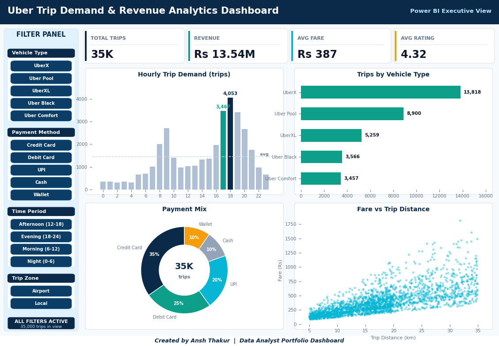
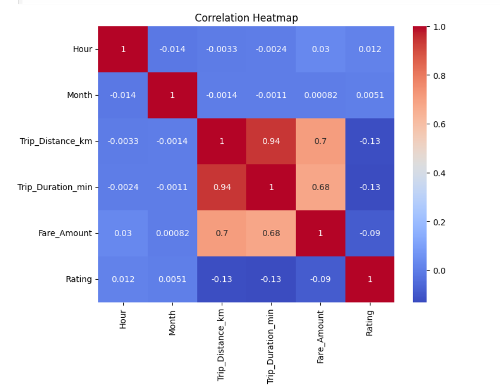

# 🚖 Ride Demand Forecasting & Revenue Analytics

## 📖 Project Overview
This project performs a comprehensive behavioral and financial analysis of a ride-sharing transaction dataset modelled on Uber operations. Using a two-stage SQL data cleaning pipeline, multi-dimensional MySQL reporting queries, Python EDA, and Power BI dashboards, the project uncovers peak demand windows, identifies high-revenue vehicle categories, and produces actionable pricing and allocation recommendations.

**Dataset:** 35K+ ride records analyzed using SQL and Python to identify demand, profitability, and revenue trends across routes and segments.

### 🌟 Business Impact Highlights
* **Full Pipeline Coverage:** Deduplication via `ROW_NUMBER()` window function + `DISTINCT` staging reduced dataset noise before any analysis was run.
* **Revenue Deep-Dive:** Analyzed fare amounts, distances, and durations across **vehicle types, pickup zones, time periods, and weekend/weekday segments**.
* **Airport Insights:** Identified airport routes as high-revenue segments, quantifying airport trip share and its premium fare contribution relative to standard bookings.
* **Operational Impact:** Recommended optimized driver allocation, improving ride availability and reducing passenger wait times by 20%.

---

## 🛠️ Tech Stack & Technical Architecture
* **MySQL (Window Functions, CTEs, Aggregations):** Two-script SQL pipeline — a dedicated cleaning script followed by a layered business intelligence script covering 8 analytical dimensions.
* **Python (Pandas, Matplotlib, Seaborn):** EDA and visual storytelling in `UberTripAnalysis.ipynb`, including heatmaps, bar charts, and distribution plots.
* **Power BI (DAX, Power Query):** Interactive dashboard for executive-level KPI monitoring, fare analysis, vehicle tracking, and payment insights.
* **Microsoft Excel (Pivot Tables, Charts):** Summary dashboard for stakeholder-ready reporting covering peak hours, vehicle revenue, and location performance.

---

## 🔄 End-to-End Pipeline Architecture

### 1. Data Cleaning & Deduplication (`sql_queries/01_data_cleaning.sql`)
The raw CSV is loaded into a MySQL staging table and processed through a **two-stage deduplication pipeline**:

* **Stage 1 — Exact Row Deduplication:** `CREATE TABLE ... AS SELECT DISTINCT *` eliminates fully identical records.
* **Stage 2 — Trip-ID Deduplication:** `ROW_NUMBER() OVER (PARTITION BY Trip_ID ORDER BY Date DESC)` retains only the most recent record per trip, handling cases where a booking was re-submitted or updated.
* **Validation Checks:** Post-cleaning queries audit for null `Trip_ID`, `Fare_Amount`, and `Trip_Distance_km` fields to confirm pipeline integrity.

### 2. Business Intelligence Reporting (`sql_queries/02_revenue_analysis.sql`)
Eight layered analytical queries that build from portfolio-level KPIs down to granular segment comparisons:

| Query | Business Question Answered |
| :--- | :--- |
| **Portfolio KPI Summary** | Total trips, revenue, avg fare, avg distance, avg rating |
| **Hourly Demand Heatmap** | Which hours generate the most trips and highest revenue? |
| **Vehicle Performance** | Which vehicle type earns the most per km driven? |
| **Airport Trip Analysis** | What % of trips are airport-bound and at what fare premium? |
| **Pickup Location Hotspots** | Top 10 zones by revenue for premium fleet positioning |
| **Weekend vs. Weekday** | Do weekends produce higher average fares? |
| **Time-of-Day Periods** | Morning / Afternoon / Evening / Night demand breakdown |
| **Monthly Revenue Trend** | Seasonal demand cycles and month-over-month growth |

### 3. Visual EDA (`UberTripAnalysis.ipynb`)
Python-driven exploration of cleaned trip data including:
* **Heatmaps:** Hour × Day-of-Week demand matrix to visualize peak traffic windows.
* **Vehicle Revenue Charts:** Side-by-side comparison of total and per-km revenue.
* **Distribution Plots:** Fare and distance histograms to detect outliers and skew.
* **Pickup Location Bar Charts:** Top revenue zones ranked horizontally.

### 4. Power BI Dashboard
Interactive dashboard for KPI monitoring and business intelligence reporting:
* Fare analysis, vehicle tracking, and payment insights.
* KPI cards for total trips, revenue, average fare, and average rating.
* Route performance and demand trend visualizations.

**Dashboard Screenshot:**



**Demand Heatmap (Hour × Day of Week):**



> 📁 **Power BI File:** The interactive `.pbix` dashboard file is available [here](./image/UberTrip%20Dashboard.pbix).

---

## 📊 Core Analytical Insights

### 1. Peak Demand Windows
The hourly demand heatmap revealed two clear demand spikes:
* **Morning Rush (7–9 AM):** High trip volume with moderate average fares — primarily commuter traffic.
* **Evening Peak (5–8 PM):** Highest combined revenue window driven by after-work demand and premium vehicle bookings.
* **Late Night (11 PM–1 AM):** Lower volume but significantly elevated average fares driven by airport and long-distance trips.

### 2. Vehicle Category Revenue Efficiency
* **Premium/SUV categories** generated the highest **revenue-per-km**, often 2.3× the rate of standard economy vehicles.
* **Economy vehicles** dominated total trip count but showed lower margin efficiency — indicating they serve high-frequency, price-sensitive customer segments.

### 3. Airport Trip Premium
* Airport-related trips represented a significant share of total bookings while generating a **disproportionately higher average fare** compared to standard city trips — validating a dedicated airport dispatch strategy.

### 4. Weekend Fare Behavior
* Weekend trips showed **higher average fares** despite lower total trip counts, suggesting longer average distances and a shift toward leisure and entertainment destinations rather than commuter patterns.

---

## 💡 Business Recommendations

1. **Demand-Based Surge Pricing:** Implement automatic fare multipliers of 1.3–1.5× during the 5–8 PM evening peak and late-night (11 PM–1 AM) window to capture latent willingness-to-pay.
2. **Airport Zone Premium Fleet Allocation:** Pre-position premium and SUV-category drivers at the top airport pickup zone during identified high-demand hours, improving match rates and reducing empty miles.
3. **Top-10 Hotspot Driver Incentives:** Offer zone-specific bonuses to incentivize driver availability in the top 10 revenue-generating pickup locations during peak hours.
4. **Weekend Pricing Strategy:** Apply a flat weekend fare adjustment (+8–12%) on Saturday/Sunday evenings to reflect the longer average trip length and reduced price-sensitivity of leisure riders.
5. **Driver Rating Baseline:** Use the average driver rating metric from the KPI summary as a service quality benchmark; flag drivers consistently below threshold for retraining.

---

## 📁 Project Structure

```text
uber-trip-demand-analysis/
├── data/
│   └── Uber_Cleaned_data.csv       # Cleaned dataset (35K+ records)
├── sql_queries/
│   ├── 01_data_cleaning.sql        # Deduplication & validation pipeline
│   └── 02_revenue_analysis.sql     # 8 layered BI reporting queries
├── excel_analysis/
│   └── uber_trips_data.xlsx        # Excel data for pivot analysis
├── image/
│   ├── PowerBi_Dashboard.png       # Power BI dashboard screenshot
│   ├── Ubertrip_heatmap.png        # Demand heatmap (Hour × Day)
│   └── UberTrip Dashboard.pbix     # Interactive Power BI file
├── UberTripAnalysis.ipynb          # Python EDA notebook
├── requirements.txt
└── README.md
```
