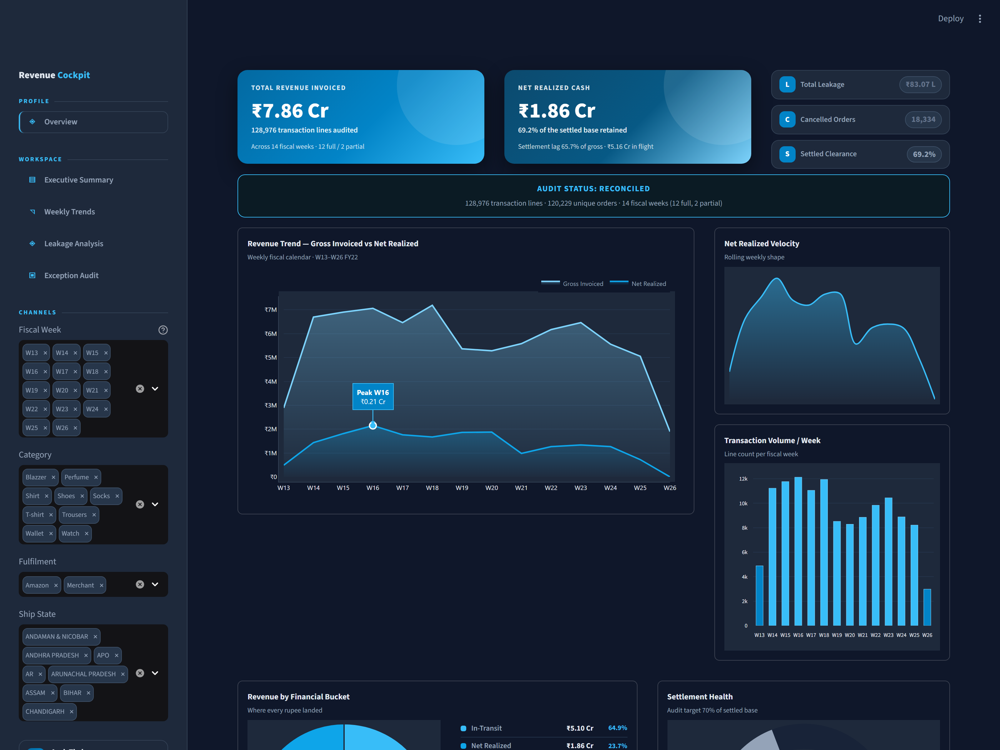
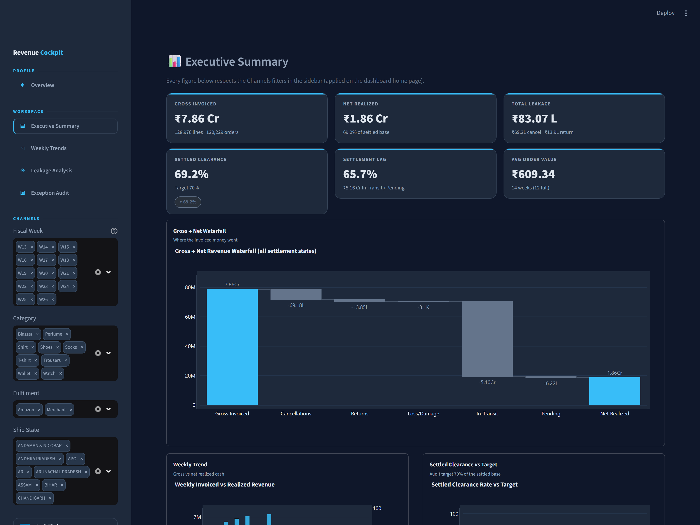
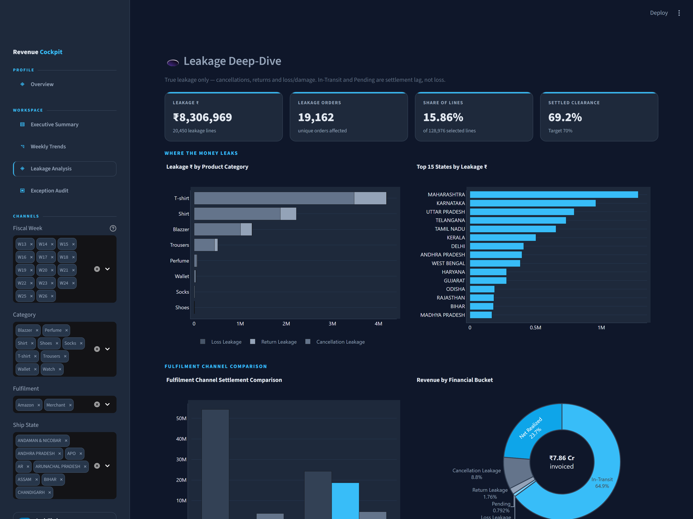
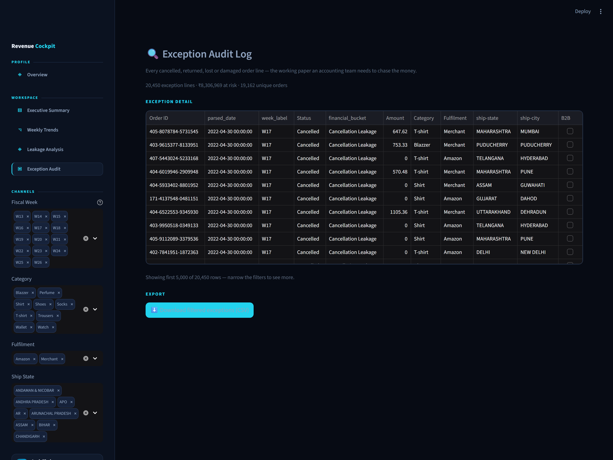
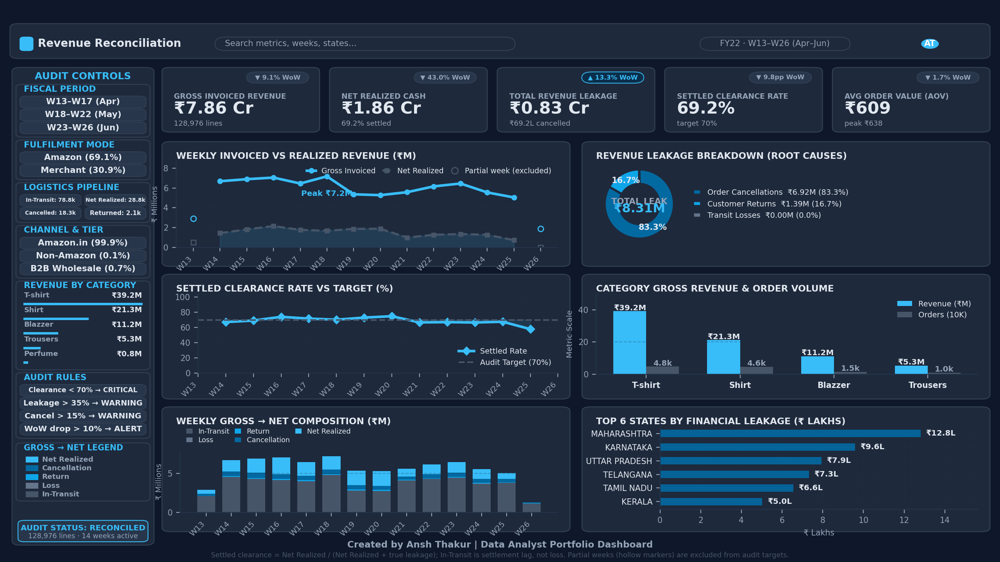
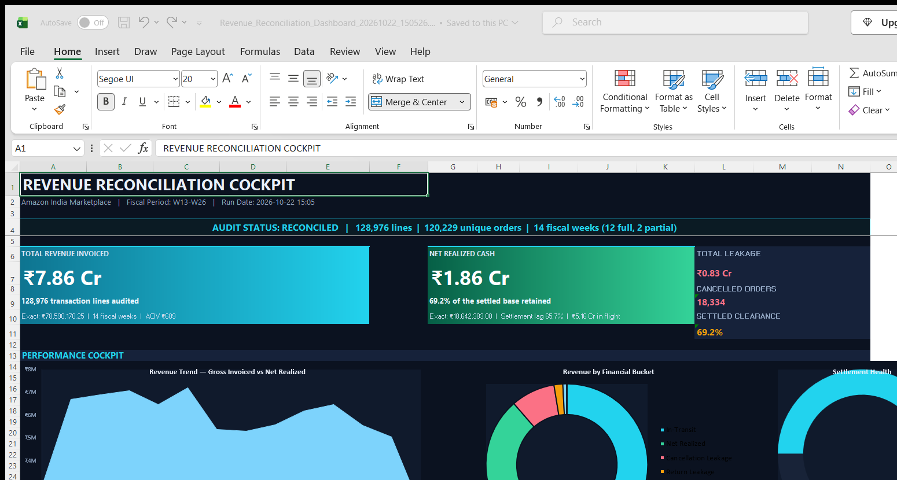
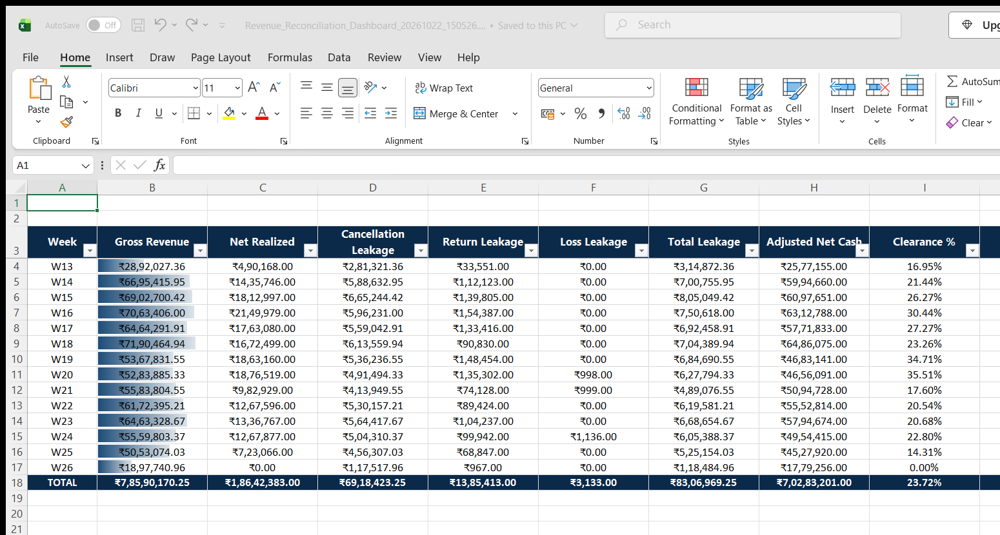
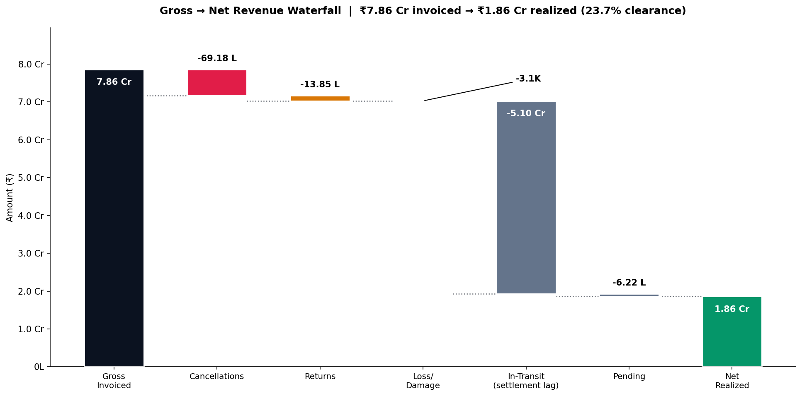

# E-Commerce Weekly Revenue Reconciliation & Leakage Audit Engine

<p align="center">
  <b>Production-grade Amazon Marketplace financial pipeline</b><br/>
  <sub>Part of <code>data-analytics</code> portfolio repo · 128,976 transactions · ₹7.86 Cr Gross · W13–W26 FY22</sub></p>

<p align="center">
  
  
  
  
  
  
  
  
[](https://github.com/ansht21/data-analytics/actions/workflows/weekly-revenue-reconciliation-engine.yml)

  
</p>

---

## 📌 Overview

A **finance-grade reconciliation engine** that turns raw Amazon India
Marketplace sales exports into audit-ready truth. It answers the question
every e-commerce finance team asks weekly and rarely answers honestly:

> **“We invoiced ₹7.86 Cr — how much cash did we actually realise, where did
> the rest leak, and which weeks are drifting out of control?”**

The engine ingests **128,976 transaction rows (₹78,590,170.25 gross across
120,229 unique orders, 31-Mar → 29-Jun-2022)**, runs an **11-step cleaning
pipeline**, classifies every order into a **financial bucket**
(Net Realized / Cancellation / Return / Loss / In-Transit / Pending),
computes weekly **Gross-vs-Net KPIs with WoW variance**, separates **true
leakage from settlement lag**, fires **config-driven anomaly alerts**, and
ships **two reporting layers**:

1. 📊 **Automated Executive Excel Workbook** — 6 KPI cards, live Excel
   formulas, native combo chart, conditional formats, 20,450-row exception audit.
2. 🖥️ **Interactive Streamlit Cockpit** — 5 pages of Plotly drill-down with
   global filters and one-click CSV export for accounting teams.

> **Project type:** 100% deterministic rules engine (Python ETL + finance
> analytics pipeline) — **no ML/AI models**. Same CSV in → same Excel out,
> every run. All business logic is auditable `Status → bucket` lookups and
> `SUM()` math in `src/reconciliation/` with thresholds in
> `config/settings.yaml`.

---

## 🖥️ Live Dashboard (Streamlit)

<p align="center">
  <b>Dark "Metric Flow" executive cockpit — 5 pages, global filters, Plotly drill-down</b>
</p>

<a href="docs/images/01_dashboard_home.png">
  
</a>

*The cockpit home page: audit status banner, four KPI cards (Gross Invoiced ₹7.86 Cr · Net Realized ₹1.86 Cr · Leakage ₹83.07 L · Settled Clearance 69.2 %), weekly revenue vs clearance against target, revenue-by-bucket donut and the full weekly reconciliation matrix. The **Audit Controls** sidebar (fiscal week, category, fulfilment, ship state) drives every page.*

| Executive Summary | Leakage Deep-Dive | Exception Audit |
|:---|:---|:---|
| <a href="docs/images/02_executive_summary.png"></a> | <a href="docs/images/04_leakage_analysis.png"></a> | <a href="docs/images/05_exception_audit.png"></a> |

**Dashboard capabilities**
- 🧭 **Global filters** — fiscal week, category, fulfilment channel and ship state; every chart, KPI and table on every page re-computes from the filtered set
- ⚡ **Session-cached** — the 11-step pipeline runs once per session, not once per widget interaction
- 🎯 **Partial weeks marked** — W13/W26 render as hollow markers with the line broken, so a truncated window never reads as a collapse
- 🧾 **Exception audit** — every cancelled / returned / lost line with one-click CSV export

> Run it: `streamlit run streamlit_app/Dashboard.py` → http://localhost:8501

---

## 🖼️ Executive Analytics Cockpit (static render)


*Fully data-driven render: ₹78.59M invoiced across 128,976 lines, ₹8.31M of true leakage broken into cancellations / returns / transit losses, top leakage states and cities, and weekly settled-clearance tracking against the 70% audit target.*

---

## 📊 Automated Executive Excel Dashboard (`openpyxl`)

> Generated with 1 command (`python run_pipeline.py`) — a production-ready multi-tab Excel workbook featuring 6 KPI cards, native Excel Bar/Line combo charts, dynamic `=SUM()` and `=IFERROR()` formulas, and conditional formatting data bars.

### Tab 1 · Executive KPI Dashboard & Dynamic Combo Chart
<a href="docs/images/06_excel_executive_dashboard.png">
  
</a>

### Tab 2 · Weekly Trends Matrix & Data Bars (W13–W26)
<a href="docs/images/07_excel_weekly_trends.png">
  
</a>

### 💧 Gross → Net Waterfall (where the ₹7.86 Cr went)
<a href="docs/images/08_gross_to_net_waterfall.png">
  
</a>
*₹7.86 Cr invoiced → ₹1.86 Cr realized. ₹5.10 Cr sits In-Transit — settlement lag, not loss. True leakage: ₹69.18 L cancellations + ₹13.85 L returns. Generated with `python scripts/make_waterfall.py` from real parquet data.*

---

## 📈 Verified Findings (W13–W26 FY22 — regenerate with `python run_pipeline.py`)

| Metric | Value | Note |
|:---|---:|:---|
| Gross Invoiced Revenue | **₹78,590,170.25** | 128,976 order lines · 120,229 unique orders |
| Net Realized Cash | **₹18,642,383.00** | 28,756 *Delivered to Buyer* orders |
| **Settled Clearance Rate** | **69.18 %** | Net ÷ (Net + true leakage) — the audit metric |
| Cancellation Leakage | **₹69,18,423.25** | 18,334 orders — largest leakage leg (83.3 % of leakage) |
| Return Leakage | **₹13,85,413.00** | 2,110 orders — Returned / Returning / Rejected |
| Loss / Damage Leakage | **₹3,133.00** | 6 orders — Lost in Transit + Damaged |
| **Total Revenue Leakage** | **₹83,06,969.25** | 30.82 % of the settled base |
| Settlement Lag (In-Transit + Pending) | **₹5.16 Cr** | 65.74 % of gross — *not* loss, still settling |
| Gross Coverage Rate | 23.72 % | Net ÷ gross — low only because GMV is still in flight |
| Anomaly Triggers | **12** | 6× CRITICAL, 4× WARNING, 3× ALERT (partial weeks excluded) |

**Anomaly examples fired by the engine (real output):**

| Week | Severity | Rule Triggered | Value |
|:---|:---|:---|---:|
| W14 | 🔴 CRITICAL | Settled clearance 67.20 % < 70 % | 67.20 % |
| W21 | 🔴 CRITICAL | Settled clearance 66.77 % < 70 % | 66.77 % |
| W25 | 🔴 CRITICAL | Settled clearance 57.93 % < 70 % | 57.93 % |
| W21 | 🟠 ALERT | WoW Net −47.62 % < −10 % | −47.62 % |
| W25 | 🟠 ALERT | WoW Net −42.97 % < −10 % | −42.97 % |

> **The metric that matters.** 61 % of order lines are still *In-Transit* when
> the export was taken, so a "Net ÷ gross" clearance rate of 23.7 % says
> almost nothing about money the business actually lost. The engine therefore
> reports **two separate numbers**: *settled clearance* (69.18 % — of the
> money that reached a final state, we kept 69 %) and *settlement lag*
> (₹5.16 Cr still moving). Finance can now chase the right money: the
> ₹83.07 L of true leakage, not the ₹5.16 Cr of in-flight orders.

---

## 🧮 Reconciliation Math (single source of truth in `src/reconciliation/`)

| KPI | Formula |
|:---|:---|
| Gross Invoiced | `SUM(Amount)` per fiscal week |
| Net Realized | `SUM(Amount)` where bucket = *Net Realized* |
| Total Leakage | Cancellation + Return + Loss bucket sums |
| Settled Base | `Net Realized + Total Leakage` (excludes In-Transit) |
| **Settled Clearance %** | `(Net Realized / Settled Base) × 100` ← audit metric |
| Gross Coverage % | `(Net Realized / Gross Invoiced) × 100` ← settlement lag |
| Cancellation Rate % | `(Cancelled orders / Total orders) × 100` |
| WoW Growth % | `((Current Net − Prior Net) / Prior Net) × 100` |

**Anomaly rules (all thresholds live in `config/settings.yaml`):**

- 🔴 **CRITICAL** — weekly Settled Clearance % < 70
- 🟠 **WARNING** — leakage share of the settled base > 35 %
- 🟠 **WARNING** — weekly Cancellation % > 15
- 🟡 **ALERT** — WoW Net Revenue drop worse than −10 %

> Partial weeks (W13 = 4 days, W26 = 3 days — the edges of the export
> window) are flagged `is_partial_week` and excluded from anomaly detection,
> so a truncated week can never raise a false alarm.

---

## 🏗️ Architecture

```
data/raw/Amazon_Sale_Report.csv (128,976 rows × 21 cols)
        │
        ▼
src/data_loader.py ── 11-step cleaning
   ① drop dead cols ② mixed-date parse ③ null Amounts → 0
   ④ currency → INR ⑤ state/city standardise ⑥ postal cleanup
   ⑦ FBA imputation ⑧ ISO fiscal tagging (W13–W26)
   ⑨ status → bucket map ⑩ schema validation (fail-fast)
   ⑪ parquet export
        ▼
data/processed/cleaned_transactions.parquet
        │
   ┌────┴─────────────┐
   ▼                  ▼
engine.py          variance_analyzer.py
(weekly KPIs)      (WoW + anomaly rules)
   │                  │
   ├────────┬─────────┤
   ▼        ▼         ▼
Excel    Streamlit   exception_audit.csv
3-tab    4-page      (accounting export)
workbook dashboard
```

Every layer is **config-driven** (`config/settings.yaml`): paths, bucket
mapping and all thresholds — zero hardcoded business logic.

---

## 🚀 Quickstart

```bash
# 1. Install
pip install -r requirements.txt

# 2. Run the full pipeline (cleans data + writes Excel workbook + CSV)
python run_pipeline.py
#    -> reports/Revenue_Reconciliation_Dashboard_<timestamp>.xlsx
#    -> reports/exception_audit.csv
#    -> data/processed/cleaned_transactions.parquet

# 3. Launch the interactive dashboard (http://localhost:8501)
streamlit run streamlit_app/Dashboard.py
```

### CLI flags

```bash
python run_pipeline.py --week W20           # focus a single fiscal week
python run_pipeline.py --no-excel           # clean + aggregate only
python run_pipeline.py --output-dir out/    # custom report destination
python run_pipeline.py --config my.yaml     # alternate settings file
```

### Make targets

| Target | Action |
|:---|:---|
| `make run` | Full pipeline + Excel workbook |
| `make streamlit` | Launch dashboard on :8501 |
| `make test` | pytest + coverage report |
| `make lint` | Ruff lint |
| `make typecheck` | MyPy pass |
| `make docker` | Build container image |
| `make clean` | Remove generated artifacts |

---

## ✅ Testing & CI/CD

- **28/28 pytest tests passing** — unit suites for data loader, classifier,
  engine math, fiscal calendar, metrics layer, workbook builder + a full
  end-to-end integration test (synthetic CSV → clean → KPIs → workbook).
- **Ruff lint:** all checks passed · **MyPy:** typed end-to-end.
- **CI** — GitHub Actions workflow `weekly-revenue-reconciliation-engine.yml`
  (`lint` → `test` with coverage gate **≥ 80 %** → `build`), plus the
  repo-root `.gitlab-ci.yml` which runs the same lint + test stages for
  this project alongside the Pipeline Contract Agent.

### Docker

```bash
docker build -t weekly-revenue-reconciliation-engine .
docker compose up dashboard     # dashboard on :8501
docker compose run pipeline     # one-shot Excel generation
```

---

## 📂 Project Structure

```
weekly-revenue-reconciliation-engine/
├── config/                  settings.yaml + logging.yaml (all thresholds)
├── data/
│   ├── raw/                 Amazon_Sale_Report.csv (Kaggle CC0)
│   ├── processed/           cleaned_transactions.parquet
│   └── archive/             historical run backups
├── src/
│   ├── config.py            typed dataclass YAML parser
│   ├── logger.py            rotating-file logging factory
│   ├── data_loader.py       11-step ingestion & cleaning
│   ├── reconciliation/      engine · metrics · fiscal_calendar ·
│   │                        revenue_classifier · variance_analyzer
│   ├── reporting/           excel_dashboard · kpi_cards · charts · formatters · tabs_*
│   └── utils/               date_utils · file_utils
├── streamlit_app/
│   ├── Dashboard.py         entry point (cockpit home)
│   ├── theme.py             shared dark palette + CSS + Plotly skin
│   ├── common.py            cached loader, global filters, KPI card helpers
│   ├── pages/               1_Executive · 2_Weekly_Trends · 3_Leakage · 4_Exception_Audit
│   └── components/          kpi_cards · charts (Plotly figures)
├── tests/                   7 suites · 28 tests · full integration
├── docs/                    architecture · data_dictionary · deployment_guide · images/
├── scripts/                 shoot.py (screenshots) · make_waterfall.py ·
│                            render_executive_dashboard_cockpit.py
├── reports/                 generated workbooks (timestamped)
├── run_pipeline.py          CLI entry point
├── Makefile · Dockerfile · docker-compose.yml
└── pyproject.toml · requirements.txt · requirements-dev.txt · .env.example
```

---

## 🚧 Known Gaps (open, tracked)

Honest status of this project — nothing here is broken, but it is not finished:

| # | Gap | Where | How to close |
|:--|:---|:---|:---|
| 1 | GitLab project **description and topics are empty** | project settings page | Set via https://gitlab.com/ansht_121/data-analytics/edit — the stored API token returns 401 (it still works for `git push`), so it must be done in the web UI |
| 2 | This project has no **first green run** on the parent repo's GitLab pipeline yet | CI | Push to `data-analytics` and check the pipeline badge |

> ✅ **Closed since the last update:** the stale Excel screenshots
> (`docs/images/06_…png` / `07_…png`) were regenerated against the current
> build — `python run_pipeline.py` then `python scripts/capture_excel_sheets.py`
> (needs Excel + `pywin32`; the capture range was widened to `A1:R22` for the
> 4 new Trends columns).

> **Data quirk (already verified against the raw CSV, and now documented in
> [`docs/data_dictionary.md`](docs/data_dictionary.md)):** in this Kaggle
> export the `Fulfilment` column tracks **dispatch state**, not a business
> channel — every `Shipped - Delivered to Buyer` row is flagged `Merchant` and
> every `Shipped` row is flagged `Amazon`. A channel comparison therefore
> legitimately shows Amazon net = ₹0. The cockpit chart is titled
> *"Settlement Split by Fulfilment Flag"* to avoid implying a channel split.

---

## 🏷️ Naming by Platform

| Platform | Name |
|:---|:---|
| Repository / Folder | `weekly-revenue-reconciliation-engine` |
| Resume / CV | E-Commerce Weekly Revenue Reconciliation & Leakage Audit Engine |
| Portfolio / LinkedIn | Amazon Marketplace Revenue Reconciliation & Financial Analytics Engine |

---

<div align="center">

### Built by **Ansh Thakur** — Data Analyst

[](https://ansh-thakur-netlify.netlify.app/)
[](https://www.linkedin.com/in/ansh-thakur-5407192b4/)
[](https://github.com/ansht21)
[](https://gitlab.com/ansht_121)
[](mailto:ansht1194@gmail.com)

*I answer business questions with data — including the ones where the answer is “don’t do it.”*

</div>


